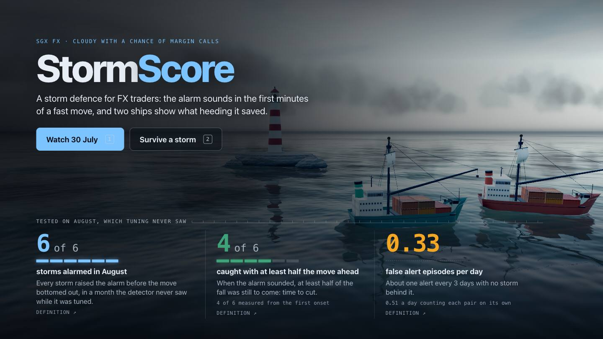
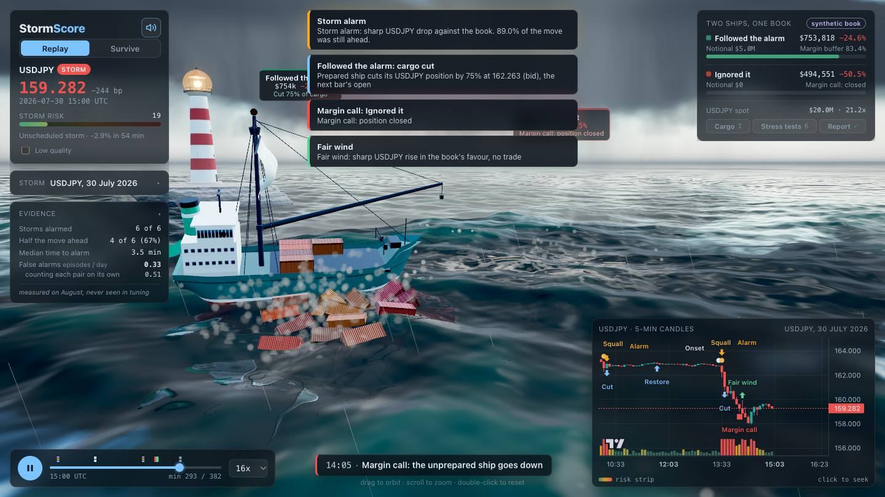
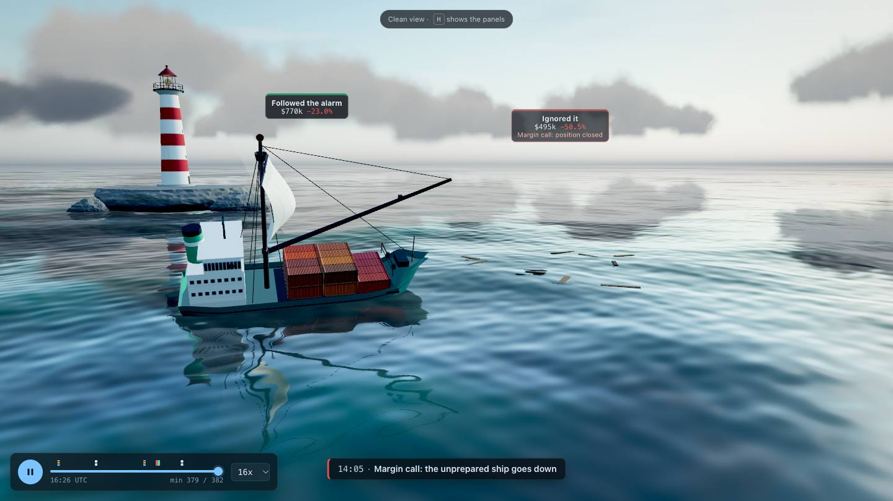
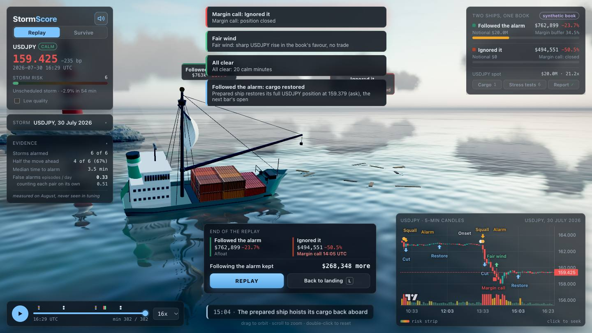
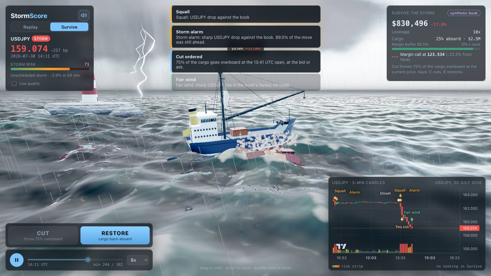
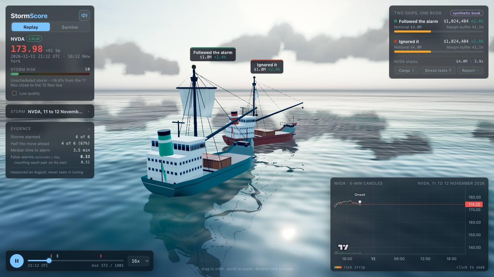

# StormScore

**A storm defence for FX traders, shown as a live 3D sea.**

In five lines:

1. StormScore replays real FX storms as a 3D sea, with two ships: one followed the alarm, one ignored it.
2. We found little warning in prices, so it never predicts: it warns from a calendar, alarms in the first minutes, and prepares the book.
3. On August, which tuning never saw: 6 of 6 storms alarmed, 4 of 6 caught early enough to cut, 0.33 false alerts a day.
4. On frozen tests on other data it catches fewer than half in time, and on stocks it does worse: the misses are in the tables.
5. The trader's book is synthetic, every number is computed by code, and *Survive the storm* teaches a beginner where the margin-call line sits.

Built for SGX FX's **Challenge 1, "Cloudy with a chance of margin calls"**: warn a trader before leverage turns a fast move into a margin call. It also answers **Challenge 2, "Every trader needs to start somewhere"**. StormScore replays a real storm from SGX's one-minute FX data: the sea and sky turn, an alarm fires, two ships show what the warning saved, and a short storm report follows, every number of it checked by code.

**How we built it:** 24 hours at DurHack 2026, with Claude Code and Codex working under strict file ownership, every result checked by tests and two independent audits.


<table>
<tr>
<td width="50%"><br><sub>The landing page, with the August figures.</sub></td>
<td width="50%"><br><sub>30 July at 14:05: the alarm, the cut, and the margin call on the ship that ignored it.</sub></td>
</tr>
<tr>
<td><br><sub>The presenter's clean view (H): ships, captions, timeline.</sub></td>
<td><br><sub>The end card: $762,899 against $494,551.</sub></td>
</tr>
<tr>
<td><br><sub>Survive the storm, after a cut at the alarm.</sub></td>
<td><br><sub>The NVDA replay (Yahoo trades, no quotes).</sub></td>
</tr>
</table>

Screenshots from the demo QA run ([docs/qa/report.md](docs/qa/report.md)): all 18 storms in the index played to the end at 16x with no page errors and no NaN pixels, and the presenter flow passed 13 of 13 steps.


## What the data showed

Two months of SGX one-minute bars (1 July to 31 August 2026; EURUSD, USDJPY, USDSGD) hold 13 storms, defined in [docs/metrics.md](docs/metrics.md). **We found little advance warning in prices.** `scripts/no_warning_check.py` measures volatility, spread and forward points in the 90 minutes before each storm and ranks them against normal windows of the same pair at the same time of day, leaving out any window that overlaps a storm, from 60 minutes before its first onset to 60 minutes after its end (full method and per-storm table in [docs/no_warning_check.md](docs/no_warning_check.md)):

- **Volatility** in the 90 minutes before onset was above the 95th percentile of normal for **1 of 13** storms (chance alone gives about 0.65 of 13); the median storm sat at the 66.7th percentile. The one exception is the 3 August USDJPY storm, which began in the first hours after the Sunday-evening open.
- **Spread** was above the 95th percentile for **3 of 13**: that same storm, and the EURUSD and USDSGD storms of 2 July, whose pre-window leads into the 12:30 US payrolls release. Spreads widen ahead of a release that is already on the calendar. That is the calendar's warning, not a price signal.
- **Forward points** (1W, 1M, 3M) were above the 95th percentile for 1, 2 and 0 of 13 storms (and above the 90th for 4, 3 and 2).
- Measured from `first_onset` instead (the stricter test: the 90 minutes before it hold none of the storm), volatility is again above the 95th percentile for 1 of 13, and 3M forward points for 2 of 13.

Thirteen storms ranked against about 40 days each is a small test; "little" is what it can say, not "none".

Whether a storm was **scheduled** is a different question, and the answer is mostly yes. A storm is scheduled when its onset is within 15 minutes of a release in [contracts/calendar.csv](contracts/calendar.csv):

<!-- metrics-table: -->
| metric | `value` | meaning |
|---|---|---|
| `by_kind.all_months.combined.storms` | 13 | storms in July and August |
| `by_kind.all_months.scheduled.storms` | 9 | onset within 15 min of a calendar release |
| `by_kind.all_months.unscheduled.v1.storms` | 4 | no release nearby |

Hence three defences, and no price predictions, ever:

1. **Warn ahead** for scheduled events, from the calendar: a watch opens 30 minutes before a release.
2. **Alarm in the first minutes** of unscheduled ones: the detector fires once the move is under way, with most of it still ahead.
3. **Prepare the book**: exposure, margin buffer and stress tests, so the cut is already decided when the alarm sounds.

## Results on August (which tuning never saw)

The alarm was tuned on July only. August, 6 storms, is the test split. Every metric below is named exactly as in `data/processed/metrics.json` and defined in [docs/metrics.md](docs/metrics.md). `v1` is the shipped detector; `naive` alarms on the first minute the 15-minute move already exceeds the storm threshold (the labelling rule itself). `caught` means at least 50% of the onset-to-trough move was still ahead when the alarm fired. Six storms is a small sample: one storm moves a share by 17 points.

**Alarm** (direction-agnostic, scored on the pair of each storm):

<!-- metrics-table: methods.{col}. -->
| metric | `v1` | `naive` | meaning |
|---|---|---|---|
| `storms` | 6 | 6 | labelled storms in August |
| `alarmed` | 6 | 6 | storms with a matching storm-level alarm |
| `caught` | 4 | 1 | alarm with at least 50% of the move still ahead |
| `median_move_ahead_pct` | 57.4 | 6.2 | % of the move still ahead at the alarm, vs onset |
| `median_minutes_to_alarm` | 3.5 | 13.0 | minutes after onset, vs onset |
| `caught_first_onset` | 4 | 1 | `caught`, measured from first_onset |
| `median_move_ahead_pct_first_onset` | 57.6 | 6.3 | % ahead, vs first_onset |
| `median_minutes_to_alarm_first_onset` | 9.0 | 15.0 | minutes after first_onset |
| `days` | 21.52 | 21.52 | observed days (1,440 minutes with a bar on any pair) |
| `false_alarms` | 11 | 0 | pair alarms outside every storm's window |
| `false_alarms_per_day` | 0.51 | 0.0 | pair alarms per observed day: USDJPY and USDSGD alarming together count twice |
| `false_alarm_episodes` | 7 | 0 | the same alarms, grouped when within 15 min of an episode's first |
| `false_alarm_episodes_per_day` | 0.33 | 0.0 | distinct alert episodes per observed day |

The naive baseline had no false alarms in August. That is what August's data showed, not a property of the rule: it fires when a 15-minute window crosses the storm threshold, and a crossing that the 6-hour merge later folds into a bigger storm, hours before that storm's onset, is a false alarm (a two-drop synthetic series gives one, `test_5_naive_baseline_false_alarms_on_the_two_drop_toy` in [backend/tests/test_audit2.py](backend/tests/test_audit2.py)). It is a ruler for lateness, not a competitor. Onset is the start of the storm's strongest 15-minute window, which is known only in hindsight, so `first_onset` is reported next to it.

**Watch and coverage** (the calendar defence):

<!-- metrics-table: -->
| metric | `value` | meaning |
|---|---|---|
| `watch_precision` | 0.29 | releases whose watch window held a storm / all releases |
| `watch.august.releases` | 7 | calendar releases in August |
| `watch.august.with_storm` | 2 | releases with a storm onset in their watch window |
| `watch.august.quiet` | 5 | quiet watches |
| `by_kind.test.scheduled.storms` | 4 | scheduled storms in August |
| `by_kind.test.scheduled.watched_before_onset` | 4 | of them, watched before onset |
| `by_kind.test.scheduled.median_warning_minutes` | 28.5 | minutes from first watch minute to onset |
| `by_kind.test.scheduled.min_warning_minutes` | 20 | the shortest warning |
| `by_kind.test.combined.storms` | 6 | all August storms |
| `by_kind.test.combined.covered` | 6 | watched before onset, or caught |
| `by_kind.test.combined.covered_pct` | 100.0 | coverage, % |

Watch precision is low, and we say so: 5 of 7 August releases passed without a storm, so a watch means "be ready", not "a storm is coming".

**Policy backtest** (synthetic three-pair book, $1,000,000 equity, 2 to 31 August; the prepared ship cuts 75% at each alarm and restores at the all-clear, filling at the next bar's open on the bid or ask):

<!-- metrics-table: policy.{col}. -->
| metric | `prepared` | `unprepared` | meaning |
|---|---|---|---|
| `final_equity_usd` | $1,033,659 | $993,889 | USD |
| `max_drawdown_usd` | $191,261 | $226,151 | largest fall from a running peak |
| `max_drawdown_pct` | 17.2 | 20.6 | %, maximised on its own, so it can come from a different peak |
| `margin_calls` | 0 | 0 | neither book was closed out in August |
| `cuts` | 11 | 0 | one per danger alarm |
| `restores` | 11 | 0 | one per all-clear |
| `fills` | 22 | 0 | cuts and restores |
| `spread_cost_usd` | $7,038 | $0 | fills' cost against mid, USD |

The defence costs spread and shows up as a shallower drawdown, not as a margin call avoided: one month, one invented book. It is a demonstration of the mechanism, not a performance claim.

### The 30 July case (July: the tuning month, so in-sample)

USDJPY fell 2.9% in 54 minutes (13:29 to 14:23 UTC) with no scheduled release nearby (the FOMC decision was 19 hours earlier). The alarm fired at 13:37, 8 minutes after onset, with 89.0% of the move still ahead. The prepared ship's cut filled at the 13:38 open bid, 162.263, and its restore at the 15:04 open ask, 159.379. The ship that ignored the alarm was closed out at 14:05.

| | Final equity | |
|---|---|---|
| Followed the alarm | $762,899 | lost $237,101, not zero: a defence, not a profit |
| Ignored it | $494,551 | margin call at 14:05 |

**The earlier move, and why the alarm is +8 minutes from onset but +215 from first onset.** The storm label joins triggering windows 6 hours or less apart, so this storm's `first_onset` is 10:02, three and a half hours before the main fall. From 10:02 USDJPY dropped 0.4% in 15 minutes (163.27 to 162.59 at 10:17; the window's 41.6 bp crossed the 30 bp storm threshold), then steadied. The detector did raise its storm alarm for that drop, at 10:18, and gave the all-clear at 11:44 after 20 calm minutes. That alarm had already cleared when the main fall began at 13:29, so it is not credited to this storm, and July's scoring counts it as a false alarm. The 13:37 alarm is the one that caught the fall: 8 minutes after the onset with 89.0% of the move still ahead, or 215 minutes after the first onset with 80.6% ahead measured from there. The replay therefore starts at 10:08, ten minutes before that alarm, instead of at onset minus 3 hours (10:29): a replay that opened at 10:29 would have opened inside the alarm, in storm state, with the prepared ship still at full size when the policy had already cut. No replay may open inside an alarm, so the window widens until it does not. Both ships start at full size at 10:08 (mid 163.2685), the prepared ship cuts 75% at the 10:19 open bid, 162.734, and restores at the 11:45 open ask, 163.014, then cuts again at 13:38. The bundle's `storm.first_onset_i` is -6, still before its first frame.

The prepared ship ended $268,348 ahead. The figure above is drawn by `scripts/make_figure.py` from the bundle; the minute-by-minute working is in [docs/metrics.md](docs/metrics.md) section 9.

## Frozen out-of-sample tests

July tuned the alarm and August tested it, which is two months of one feed. So three further tests were **frozen first**: the detector's settings, the code's fingerprints and the list of windows were registered in a commit of their own, pushed before any data was downloaded, and nothing was tuned, substituted or dropped afterwards. Each can be recomputed from the hashed raw data with no network (`cd backend && python -m storm.oos.run --verify`; `python -m storm.chips.verify`). None is evidence that prices can be predicted; each is a historical test of how fast the alarm is and how often it is wrong, and every miss is in its tables.

### Round 1: famous events and two ordinary months (another vendor's data)

Six events chosen by name (the SNB floor removal in January 2015, the sterling flash crash of October 2016, the yen flash crash of January 2019, the two interventions of September and October 2022, the carry-trade unwind of August 2024) and two ordinary months (March 2024, June 2025), on Dukascopy's one-minute bid/ask feed. Full tables, every labelled storm and every false alarm: [docs/oos/results.md](docs/oos/results.md).

<!-- metrics-table[oos1]: display.totals.{col}.metrics. -->
| metric | `events` | `ordinary` | `all` | meaning |
|---|---|---|---|---|
| `storms` | 11 | 12 | 23 | labelled storms in the windows |
| `alarmed` | 9 | 10 | 19 | storms with a matching storm-level alarm |
| `caught` | 5 | 4 | 9 | alarm with at least half the move still ahead |
| `median_move_ahead_pct` | 57.3 | 42.8 | 43.4 | % of the move still ahead at the alarm |
| `median_minutes_to_alarm` | 5.0 | 7.0 | 5.0 | minutes after onset |
| `false_alarm_episodes` | 3 | 11 | 14 | alert episodes outside every storm's window |
| `days` | 22.63 | 42.16 | 64.79 | observed days |
| `false_alarm_episodes_per_day` | 0.13 | 0.26 | 0.22 | false episodes per observed day |

The synthetic book, summed over independently reset books (USD pairs only; EURCHF and AUDJPY have no valued policy):

<!-- metrics-table[oos1]: display.totals.events.policy.{col}. -->
| metric | `prepared` | `unprepared` | meaning |
|---|---|---|---|
| `pnl_usd` | -802,978 | -1,297,798 | summed P&L, six event books |
| `margin_calls` | 3 | 3 | neither ship avoided the margin calls |
| `spread_cost_usd` | 74,723 | 56,479 | fills' cost against mid |

<!-- metrics-table[oos1]: display.totals.ordinary.policy.{col}. -->
| metric | `prepared` | `unprepared` | meaning |
|---|---|---|---|
| `pnl_usd` | -340,201 | -332,668 | summed P&L, two ordinary-month books |
| `spread_cost_usd` | 4,746 | 0 | fills' cost against mid |

**Honest limits.** The events are stress cases picked by name, so their catch rate (5 of 11) says how the alarm behaves in a crash, not how often it will catch one. The detector alarmed on 19 of 23 storms but caught only 9 with half the move still ahead. The prepared book lost less than the unprepared one over the six events in total, but not in every one: at the SNB event it ended slightly worse, and both books were margin-called. The ordinary months show the cost: 11 false alert episodes in 42.16 days. June 2025 is also inside round 2's year, so its three USD pairs are counted in both rounds.

### Round 2: a full year of 2025

*Round 2 was not finished when this was written; its results will be here once `docs/oos/results-2.json` is published.* <!-- ROUND2 -->

### The chip sector (frozen detector, stocks)

The same detector, unchanged, on 14 chip-sector tickers (NVDA, which was used to build the equity path and is reported apart, and 13 new names) over every trading day Yahoo served, 19 October to 13 November 2026: one-minute **trade** bars, not quotes. Full tables, every storm and every detection: [docs/chips/results.md](docs/chips/results.md).

<!-- metrics-table[chips]: pooled.{col}. -->
| metric | `new_tickers` | `nvda_in_sample` | meaning |
|---|---|---|---|
| `storms` | 19 | 2 | labelled storms |
| `alarmed` | 16 | 1 | storms with a matching alarm |
| `caught` | 6 | 1 | at least half the move still ahead |
| `median_move_ahead_pct` | 25.2 | 100.0 | % of the move ahead at the alarm |
| `false_alarms` | 47 | 6 | pair alerts outside every storm's window |
| `days` | 20 | 20 | distinct trading dates |
| `false_alarms_per_day` | 2.35 | 0.3 | false alerts per trading day |

**Honest limits.** The FX detector does clearly worse on stocks: 6 of 19 caught, and 2.35 false alerts per trading day against 0.33 episodes a day on FX in August. The three new replays (INTC, SMCI, MRVL, the largest moves) were all missed in time; in INTC both ships were margin-called together. The universe and the November shock week were chosen with NVDA already observed, so this is a cross-ticker test, not a future-period one. Yahoo has trades, not quotes: no spread is measured, the replay fills at the next bar's open with no cost, and thin extended-hours bars, bad prints and sector correlation affect the numbers. A detector tuned on FX is not a detector for stocks.

### Statistical evidence: against chance, with intervals

This is our most credible evidence, and it is deliberately unflattering. The `cx-stats` analysis ([docs/stats/results.md](docs/stats/results.md), preregistered in [docs/stats/preregistration.md](docs/stats/preregistration.md)) re-reads the frozen tests without changing the detector. Three datasets are scored apart: SGX August, round 1 (the historical FX events and months) and the 13 new chip tickers.

**Do the alarms beat chance?** For detection, yes, on FX. We took every alarm train and moved it to random minutes (10,000 draws, keeping each pair's alarm count and timing within the pair) and counted how many storms the moved alarms would catch with half the move still ahead. The real alarms caught 9 of 23 in round 1 where the moved ones caught a median of 0 (97.5th percentile 3), p=0.0001; and 4 of 6 on SGX August against a median of 0, p=0.0006. Both stay significant after Holm's correction (0.0006 and 0.0030). On the chips the real 6 of 19 against a median of 3 is **not** distinguishable from chance (p=0.1081; 0.1439 after correction).

**How sure are the rates?** Barely, on August: 4 of 6 is 66.7% with a storm-bootstrap 95% interval of 33.3% to 100%, and 40.0% to 100% when resampling by event date (four dates). Six storms cannot say more. Round 1's 9 of 23 is 39.1% (21.7% to 60.9%); the chips' 6 of 19 is 31.6% (10.5% to 52.6%).

**Does the money result hold up?** Not by the standard we set. The prepared synthetic book beat the unprepared one in every dataset, and pooled over FX it is +$527,056 across nine reset books, but this is a scenario total and descriptive. Against the same timing null the raw p-values are 0.0240 (chips), 0.0480 (round 1) and 0.0490 (August), and **after multiplicity correction 0 of 3 datasets survive** (0.0959, 0.1439, 0.1439). It is also sensitive to how fast you trade: with fills five bars after the signal, August's +$39,770 becomes -$10,269.

<!-- metrics-table[stats]: groups.{col}.point. -->
| metric | `sgx_august` | `oos_round1` | `chips_new` | meaning |
|---|---|---|---|---|
| `storms` | 6 | 23 | 19 | labelled storms |
| `caught` | 4 | 9 | 6 | at least half the move still ahead |
| `false_alert_episodes_per_observed_day` | 0.33 | 0.22 | 2.65 | false alert episodes per observed day (chips: per 24 h of observed minutes, 1.75 per trading day) |

<!-- metrics-table[stats]: groups.{col}.intervals. -->
| metric | `sgx_august` | `oos_round1` | `chips_new` | meaning |
|---|---|---|---|---|
| `caught_share.estimate@pct` | 66.7 | 39.1 | 31.6 | % of storms caught |
| `caught_share.ci95.0@pct` | 33.3 | 21.7 | 10.5 | lower end, storm bootstrap (10,000 draws) |
| `caught_share.ci95.1@pct` | 100.0 | 60.9 | 52.6 | upper end, storm bootstrap |
| `date_block.caught_share.ci95.0@pct` | 40.0 | 11.8 | 8.3 | lower end, resampling by event date |
| `date_block.caught_share.ci95.1@pct` | 100.0 | 65.4 | 50.0 | upper end, resampling by event date |

<!-- metrics-table[stats]: groups.{col}.chance. -->
| metric | `sgx_august` | `oos_round1` | `chips_new` | meaning |
|---|---|---|---|---|
| `caught_storms.statistic` | 4 | 9 | 6 | storms caught, observed |
| `caught_storms.null_median` | 0 | 0 | 3 | the same alarms at random times: median |
| `caught_storms.null_ci95.1` | 3 | 3 | 7 | ... and its 97.5th percentile |
| `caught_storms.p_value` | 0.0006 | 0.0001 | 0.1081 | one-sided Monte Carlo p, detection |
| `caught_storms.holm_p_value` | 0.0030 | 0.0006 | 0.1439 | after Holm correction |
| `policy_difference_usd.statistic` | 39,770 | 487,286 | 660,809 | prepared minus unprepared book, USD |
| `policy_difference_usd.p_value` | 0.0490 | 0.0480 | 0.0240 | one-sided p, money (1,000 draws) |
| `policy_difference_usd.holm_p_value` | 0.1439 | 0.1439 | 0.0959 | after Holm correction: none below 0.05 |

Prepared minus unprepared book, in USD, when the cut and the restore fill later than the next bar (August fell below zero at five bars; round 1 and the chips stayed positive):

<!-- metrics-table[stats]: groups.{col}.sensitivity. -->
| metric | `sgx_august` | `oos_round1` | `chips_new` | meaning |
|---|---|---|---|---|
| `3.policy.prepared_minus_unprepared_usd` | 39,770 | 487,286 | 660,809 | fills at the next bar (frozen headline) |
| `4.policy.prepared_minus_unprepared_usd` | 40,395 | 540,240 | 608,946 | fills two bars later |
| `5.policy.prepared_minus_unprepared_usd` | -10,269 | 406,610 | 575,271 | fills five bars later |

**Honest limits.** The timing null is conditional: it keeps each alarm's duration and each pair's alarm count, and it asks whether the alarms are placed better than random in time, not whether a random trader would do worse; it is not a causal experiment. The interval method assumes independent storms, which same-day storms on different pairs are not, so the date-block row is the cautious one. The synthetic books are scenario totals: FX uses 20x gross with a 2.5% maintenance margin, the chips 4x with 15%, and the sums across weekly reset books are not one investable portfolio. Yahoo has trades, not quotes, so the chips have no spread cost and no spread sensitivity. Pooling the datasets does not create a new holdout. Round 2 was still pending when this analysis was written.

## The replay

The 3D scene is driven by bundle fields, nothing is decoration; [web/README.md](web/README.md) has the full table. In short:

| You see or hear | It means |
|---|---|
| Wave height and chop | volatility against its trailing 24 h level (`vol_ratio`) |
| Sky darkness, cloud, fog, rain | the risk score (0 to 1) |
| Wind, rain slant | state: calm, watch, storm |
| Lightning and thunder | a one-minute move of at least 6 times normal |
| A front on the horizon, labelled "US Employment Situation in 12 min" | a watch for a scheduled release, closing in until the release |
| Lighthouse lamp and beam; foghorn and a voice, "Storm warning" | the storm alarm, until the all-clear |
| Amber flash | a squall: danger below storm level, no trade |
| Crates thrown overboard (splash); hoisted back | the prepared ship cuts 75%, then restores |
| Ship heels, rides lower, sinks (and the "Margin call" voice) | equity falling, the margin buffer shrinking, a margin call |
| Sun breaks through, sails fill | a fair wind: a storm-level move in the book's favour, no trade |
| Night lanterns, "market closed" badge | the NVDA replay's closed hours |
| Calm, tense, stormy music bed, and a soft note per market minute | state, and the price: higher price, higher pitch |

**Survive the storm** is for beginners: choose a storm and a leverage from 1x to 30x, see where the margin-call line sits on the chart, press Sail, and cut (C) or restore (R) as the same alarm sounds. A margin call sinks the ship. The end card explains in plain words what a 1% move does to your equity at that leverage, and what holding, or cutting at the alarm, would have done. How its equity is computed, and how it is checked against the backend, is in [web/README.md](web/README.md).

## The AI crew

**Models read, code judges.** Code checks every number an AI writes, and a deterministic template takes over when a check fails. The defaults below were chosen by live bake-offs on the same frozen inputs (15 November 2026; full tables, prompts and per-question results in [backend/reports/bakeoff.md](backend/reports/bakeoff.md)).

| Role | Default | What it does | Where |
|---|---|---|---|
| **Code detector** | none, it is code | Decides every alarm, watch and all-clear from the data. No model | `storm.detector` |
| **Navigator** | **Qwen 3.8 Max** (Fireworks) | Answers what-if questions ("what if USDJPY drops 3% in 30 minutes?") by calling deterministic tools (`scenario`, `stress_test`, `get_exposure`, `list_storms`) and returns a replayable what-if bundle | `storm.ai.navigator` |
| **Radio officer** | **GLM 5.3** (Fireworks) | Writes the three-or-four-sentence storm report from facts computed in code | `storm.ai.report` |
| **Inspector** | **Kimi** (`kimi-k3p1-pro`, Fireworks) | Audits every report and answer for wrong associations and invented causes. A **different model family** from both writers | `storm.ai.inspector` |
| **Private mode** | **gpt-oss-120b** on one H100 on Modal | With `LLM_PRIVATE_MODE=1` every live role, the inspector included, runs here and no external provider is called | `tools/modal/` |
| **Quartermaster** | none, it is code | The budget guard: a ledger and caps; warns at 75% of a provider's cap and refuses at 90% | `storm.ai.budget` |

Every number a model writes is extracted and must equal a fact the code computed from the bundle, exactly or rounded at the precision written. A failed check gets one correction attempt with the bad numbers; after that the report is a deterministic four-sentence template. The inspector's flag also sends a report to the template. Everything goes through one gateway, `storm.ai.llm.complete()`, which is mock unless a call is explicitly live. Details in [backend/storm/ai/README.md](backend/storm/ai/README.md).

**Reports: the same 15 bundles** (13 SGX FX storms, NVDA and the labelled synthetic fixture), Kimi inspecting all four writers:

| Report writer | Reports | First-draft numbers verified | Fallbacks | Errors | Inspector flags | Mean total | Cost / report |
|---|---|---|---|---|---|---|---|
| **GLM 5.3** (default) | 15 / 15 | 15 / 15 | 0 | 0 | 0 | 4.31 s | $0.0044 |
| Meta Muse Spark 1.3 | 15 / 15 | 15 / 15 | 0 | 0 | 0 | 10.17 s | $0.0087 |
| Meta Muse Wonder 1.0 | 15 / 15 | 15 / 15 | 0 | 0 | 0 | 6.73 s | $0.0165 |
| Qwen 3.8 Max | 15 / 15 | 15 / 15 | 1 | 0 | 1 | 6.11 s | $0.0084 |

GLM accepted all 15 first drafts; Spark accepted 14 and needed one format correction. GLM was also fastest and cheapest, so it replaced Spark as the default (restore it with `REPORT_WRITER_PROVIDER=meta REPORT_WRITER_MODEL=muse-spark-1.3`).

**Navigator: a fixed ten-question comparison** (three symbols, rises and falls, short and long durations, 10x against 40x leverage, exposure then stress, two replay shapes):

| Navigator | First-draft numbers | Final verified | Correct tools | Inspector ok | No-fallback successes | Mean latency | Under 15 s | Cost, ten questions |
|---|---|---|---|---|---|---|---|---|
| **Qwen 3.8 Max** (default) | 7 / 10 | 10 / 10 | 10 / 10 | 10 / 10 | 8 / 10 | 7.67 s | 10 / 10 | $0.133 |
| Meta Muse Wonder 1.0 | 7 / 10 | 10 / 10 | 10 / 10 | 10 / 10 | 8 / 10 | 11.60 s | 8 / 10 | $0.411 |
| Kimi k3p1-pro | 4 / 10 | 10 / 10 | 10 / 10 | 10 / 10 | 5 / 10 | 15.78 s | 4 / 10 | $0.145 |
| GLM 5.3 | 4 / 10 | 10 / 10 | 10 / 10 | 10 / 10 | 7 / 10 | 26.40 s | 2 / 10 | $0.132 |
| Meta Muse Spark 1.3 | 8 / 10 | 10 / 10 | 10 / 10 | 10 / 10 | 6 / 10 | 31.20 s | 0 / 10 | $0.195 |

"Final verified" can include a template; a "no-fallback success" needs verified numbers, correct tools, an ok inspector and generated prose. Qwen 3.8 Max ties Wonder on those and is faster and cheaper, so it is the navigator default. **Two Qwen answers still fell back to the template**; no row is perfect generated-answer reliability. Kimi inspected every row except its own, which GLM inspected.

**Private mode on Modal** (public weights, one H100, `LLM_PRIVATE_MODE=1`, writer and inspector both on Modal; 13 SGX FX bundles):

| Private writer and inspector | First-draft numbers verified | Accepted first draft | Fallbacks | Errors | Mean writer / total |
|---|---|---|---|---|---|
| **gpt-oss-120b** (default) | 13 / 13 | 11 / 13 | 0 | 0 | 5.10 s / 8.50 s |
| Qwen3-8B | 10 / 13 | 5 / 13 | 8 | 0 | 9.99 s / 10.81 s |

The privacy is real and the inspector is a separate role on the same weights, not an independent model family. The first request after idle pays a cold start (a successful cached start was 69.74 s): **wake it three to five minutes before judging** ([tools/modal/README.md](tools/modal/README.md#judging-warmth)). Code still checks every number, so a weaker private model shows up as plainer text, never as wrong figures. Spend on these comparisons, by uncached token accounting: Meta $1.48, Fireworks $1.24; Modal's $8.37 is a conservative wall-time estimate, not an invoice. Meta's Muse Spark Open is public, but its smallest official checkpoint is about 537 GB and cannot fit one available GPU.

For the chip replays, a three-bundle check of the same crews (default GLM and Kimi; private gpt-oss-120b) verified all 3 reports first time on both ([docs/chips/results.md](docs/chips/results.md)).

## Data stack

**Tiger Data (TimescaleDB).** SGX's bars are loaded into two hypertables, `spot_1m` and `forward_1m`, and the chip-sector bars into a third, `equity_1m`: 7-day chunks, compressed by series, with three continuous aggregates (`candles_5m`, `vol_1h`, `equity_5m`) behind the chart. Measured on 15 November against the live database by `scripts/tiger_bench.py` ([docs/tiger.md](docs/tiger.md) has the method and every number; raw results in [docs/tiger_bench.json](docs/tiger_bench.json)):

| Hypertable | Rows | Before compression | After compression | Ratio |
|---|---|---|---|---|
| `spot_1m` | 193,049 | 47,579,136 B | 16,097,280 B | 2.96 |
| `forward_1m` | 1,661,187 | 268,984,320 B | 26,853,376 B | 10.02 |
| `equity_1m` | 211,948 | 31,309,824 B | 5,480,448 B | 5.71 |
| all three | 2,066,184 | 347,873,280 B | 48,431,104 B | 7.18 |

Candle queries on USDJPY (5-minute candles, median of 20 runs, from a laptop over the internet): a 1-hour window takes 20.4 ms from the raw hypertable and 19.3 ms from the continuous aggregate, a day 21.8 and 22.0 ms, a week 30.9 and 25.4 ms, a month (6,208 candles) 55.9 and 38.2 ms. The round trip alone is 19.4 ms, so up to a day the network hides the difference; on the server the aggregate does 2.8 to 5.5 times less work (a month: 29.6 ms against 5.4 ms). The two results are identical. The web app works without the database; with it, the HUD shows "Live · Tiger Data" and the chart's candles come from it. See [backend/storm/live/README.md](backend/storm/live/README.md).

**ElevenLabs.** 19 sounds, generated once by `tools/audio/generate.py` and committed (`web/public/audio/`): five ambience loops (calm and rough sea, wind, rain, storm), eight one-shots (three thunders, foghorn, splash, creak, sinking, bell), three music beds and three stock-voice lines. The browser mixes them by risk and state. The **price melody is not a recording**: it is synthesised live in the browser with Tone.js, one soft note per market minute on a C-minor pentatonic scale, pitch following the price. See [web/src/audio/README.md](web/src/audio/README.md).

## Honesty notes

- **The trader book is synthetic** and labelled so everywhere: long USD 20,000,000 on $1,000,000 equity for one pair (2.5% maintenance), three equal legs in the backtest. No personal data is used.
- **The event calendar was assembled after seeing the storm list.** It lists 12 verified releases from public sources: the BLS release schedules for [July](https://www.bls.gov/schedule/2026/07_sched_list.htm) and [August](https://www.bls.gov/schedule/2026/08_sched_list.htm), and the Federal Reserve's [FOMC calendar](https://www.federalreserve.gov/monetarypolicy/fomccalendars.htm) and [August 2026 events](https://www.federalreserve.gov/newsevents/2026-august.htm). Release times are published in advance, so a watch built from them uses nothing a trader did not already have. A scheduled label states timing only; it does not claim the release caused the move.
- **Onset is defined in hindsight** (the strongest 15-minute window), so `first_onset` is reported next to it everywhere.
- **July is in-sample.** The detector was tuned on July; only August is a test, and six storms is small.
- **The NVDA case** (11 to 12 November) uses Yahoo Finance one-minute trade bars, which have trades but no quotes, so no spread is measured. Its report states market facts only: a fall of 14.4% from the 11 November close to the 12 November low, over 572 trading minutes, and it names no cause.
- **An independent review by another model family found 15 issues** in the backend (execution timing, margin order, causality of bad prints, calendar rules, stress tests, rounding, false-alarm counting, provenance). Each fix has tests: most are in [backend/tests/test_audit.py](backend/tests/test_audit.py); finding 13's (drawdown) are in [backend/tests/test_exposure.py](backend/tests/test_exposure.py), and part of finding 10 (a watch hidden at its start by a storm) is in [backend/tests/test_detector.py](backend/tests/test_detector.py). **A second independent review** rated 12 of the 15 fixed and 3 partly fixed (the stress menu was not yet point in time, provenance did not cover the code or the calendar in effect, and `first_onset` was missing from the bundles), and found new issues in the no-warning check and in this README. Those are fixed, with tests in [backend/tests/test_audit2.py](backend/tests/test_audit2.py).
- **No look-ahead in the alarm, tested.** `scripts/causality_check.py` runs the detector on the full series and on series cut off at a time T with every later bar removed: everything it says up to T is identical, at 174 cut-offs across the three pairs, and a deliberately forward-looking control is caught at every one ([docs/causality_check.json](docs/causality_check.json)). The storm labels, used only to score, are hindsight by design.
- **The out-of-sample tests are historical, and the misses are in the tables.** The famous events were chosen by name; the chip universe was chosen with NVDA already observed. See [Frozen out-of-sample tests](#frozen-out-of-sample-tests).
- **A defence, not a profit.** On 30 July the prepared ship still lost $237,101. In August the defence cost $7,038 in spread and showed up as a shallower drawdown, with no margin call avoided.
- **Known demo issues** are written up with repros in [docs/qa/report.md](docs/qa/report.md): a duplicate React key in the chart when both ships are margin-called on the same minute (INTC), a missing favicon, and toasts that pile up at 16x.
- **Never a price prediction.** The detector says a storm is under way, and the calendar says one may be near.

## How to run

You need Python 3.10 and Node (built and run here with Node 24). The demo script is:

```bash
pip install -r backend/requirements.txt      # a venv is recommended
cd web && npm install && cd ..
scripts/demo.sh                              # LIVE=1 scripts/demo.sh for real model calls
```

`scripts/demo.sh` starts the live API on :8000 if `.env` has `TIGER_DATABASE_URL`, then the web dev server, prints the URL to open (http://localhost:5173/) and stops both on Ctrl+C. It works from any checkout whose root has the `.env` (a symlink is fine), and with `LIVE=1` it sets `LLM_MODE=live`. Copy `.env.example` to `.env`; keys stay local and are never committed. Live model calls also need provider caps in `~/.stormscore/caps.json` (see `caps.example.json`).

**What works without SGX's data:** the synthetic **mock storm** replay (`contracts/mock_storm.json`, committed, labelled synthetic), Survive on it, and the backend test suite, which uses synthetic fixtures (`cd backend && python -m pytest -q`). **What needs SGX's data** (not redistributed here; place the zips in `data/raw/`): the real storms, the metrics and the figure:

```bash
cd backend
python -m storm.ingest && python -m storm.labels && python -m storm.tune && python -m storm.backtest
python -m storm.export --all                 # writes web/public/bundles/ (gitignored)
python -m storm.live.tiger --load            # optional: load Tiger Data
python ../scripts/no_warning_check.py        # the "no warning in prices" check
python ../scripts/make_figure.py             # needs matplotlib
```

The README's results tables are tested against `data/processed/metrics.json` and, for the out-of-sample tables, against `docs/oos/results.json`, `docs/oos/results-2.json` and `docs/chips/results.json`; `scripts/readme_results.py` prints the check. Two more scripts: `python ../scripts/causality_check.py` (the look-ahead test) and `python ../scripts/tiger_bench.py` (the Tiger Data timings; read-only, needs the live database).

## Repo map

| Path | What |
|---|---|
| `backend/storm/` | labels, features, detector, evaluation, backtest, exposure and equity simulators, bundle export |
| `backend/storm/ai/` | the model gateway, budget guard, navigator, report writer, inspector, verifier |
| `backend/storm/live/` | the Tiger Data loader and FastAPI live API |
| `backend/storm/oos/`, `backend/storm/chips/` | the frozen out-of-sample tests: FX holdouts on another vendor's data, and the chip-sector experiment |
| `backend/tests/` | the test suite (synthetic data), including the audit and README-results tests |
| `contracts/` | the replay bundle and API contracts, the event calendar, the synthetic mock storm |
| `web/` | the 3D replay and Survive game (React, three.js); `web/src/audio/` is the sound engine |
| `tools/audio/`, `tools/modal/` | ElevenLabs asset generation; the private GPU crew on Modal |
| `scripts/` | `demo.sh`, `make_figure.py`, `no_warning_check.py`, `readme_results.py`, `causality_check.py`, `tiger_bench.py` |
| `docs/` | metric definitions, the saved no-warning check and look-ahead check, the figure, [Tiger Data evidence](docs/tiger.md), the demo QA report (`docs/qa/`), the frozen out-of-sample tests (`docs/oos/`, `docs/chips/`) and the submission pack (`docs/submission/`: Devpost text, pitch scripts, judges' Q&A) |
| `data/` | SGX data and derived files (gitignored, not redistributed) |

## Built with

SGX one-minute FX data · React, three.js and react-three-fiber, Vite, zustand · [TradingView Lightweight Charts](https://www.tradingview.com/lightweight-charts/) (Apache-2.0; the attribution logo is kept on) · Tone.js · ElevenLabs · Tiger Data (TimescaleDB), FastAPI, psycopg · pandas, NumPy · GLM 5.3, Qwen 3.8 Max and Kimi on Fireworks, Meta Muse, and gpt-oss-120b and Qwen3-8B on Modal for the AI crew · Yahoo Finance via yfinance for the NVDA and chip-sector cases · Dukascopy's historical feed for the round-1 out-of-sample test · matplotlib for the figure · Claude Code and Codex.

## Team

TBC
