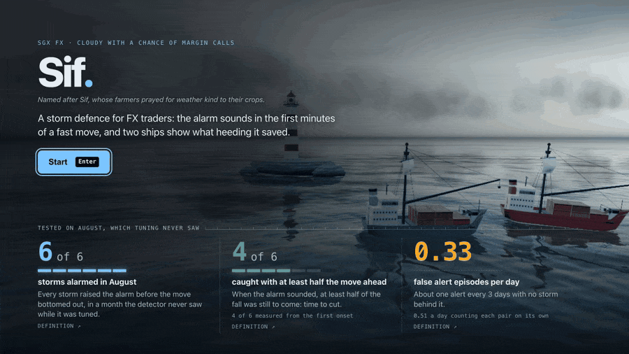
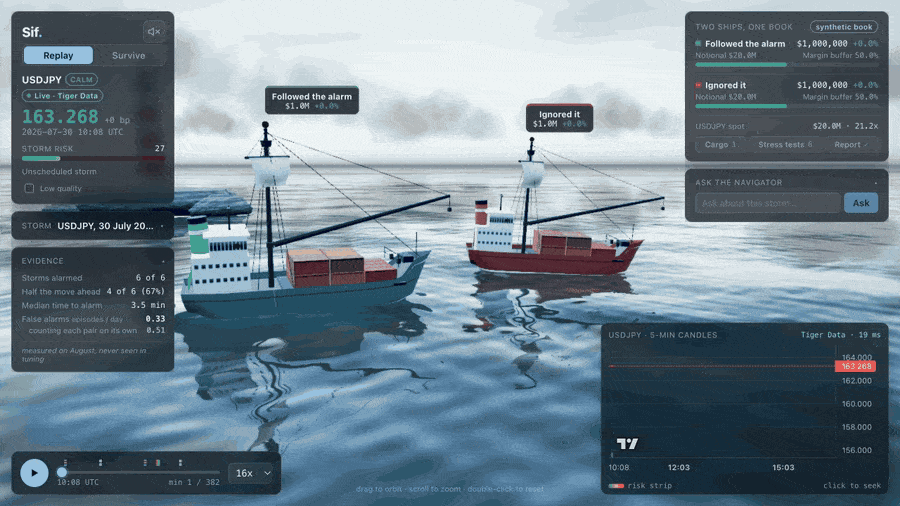
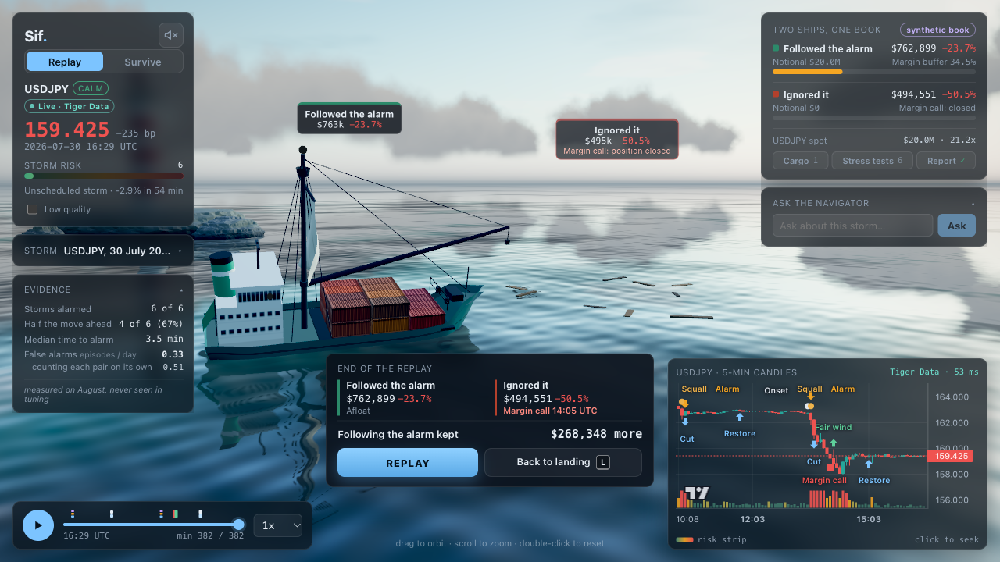
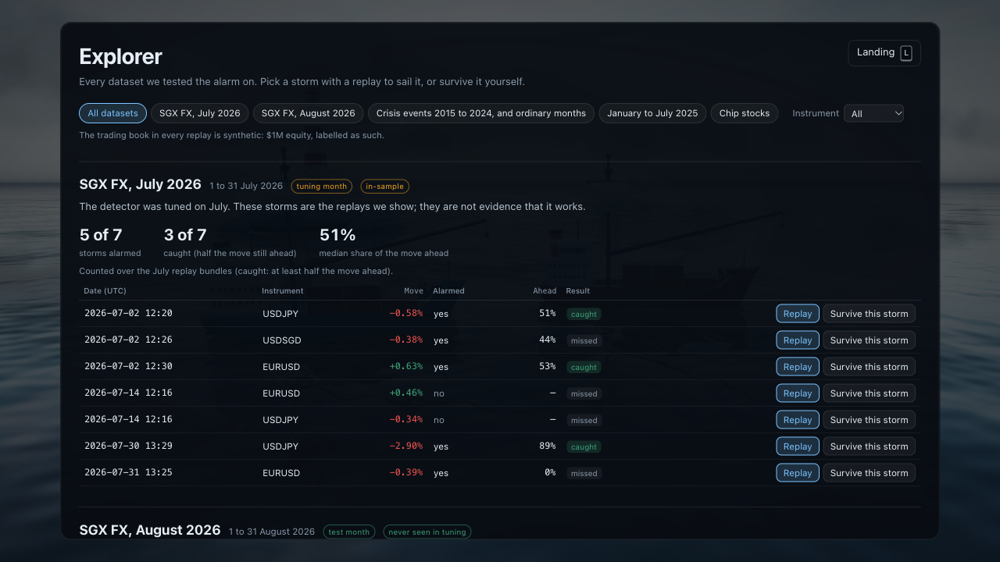
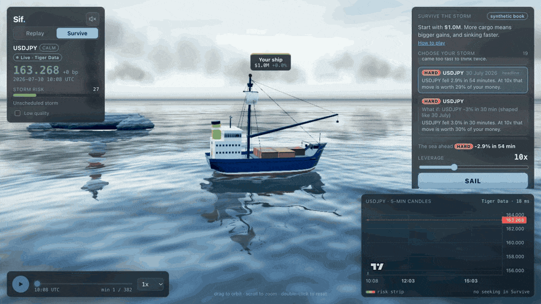
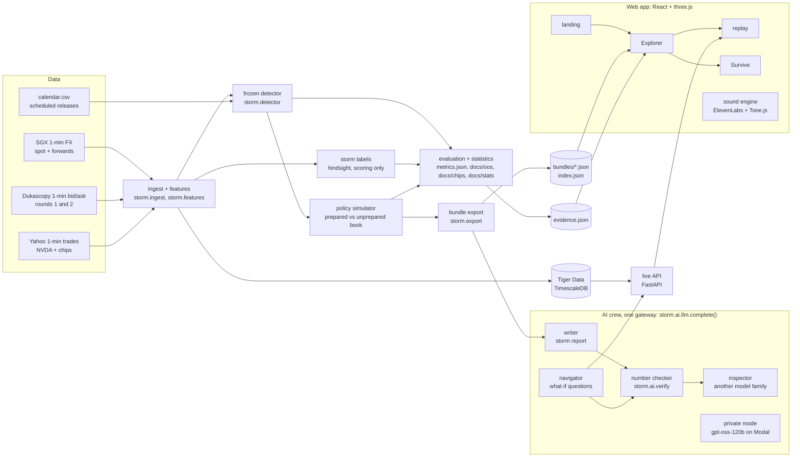

# Sif.

**A storm defence for FX traders, shown as a live 3D sea.** Sif sounds the alarm in the first minutes of a fast move, and two ships show what heeding it saved.

**▶ Watch it [here](https://youtu.be/97NzAPgNpU0)** (narrated demo, 2:17)

**Try it live:** [kamil-shirinov.github.io/Sif./](https://kamil-shirinov.github.io/Sif./) (the landing page, the Explorer and a synthetic sample storm; real market data isn't redistributed, so the real replays run in the local demo)



**Why Sif.** In Norse myth Sif is Thor's wife, tied to the harvest; farmers prayed to Thor for weather kind to their crops. Sif watches the market's weather so that a trader's book makes it through the storm.

In five lines:

1. Sif replays real FX storms as a 3D sea, with two ships: one followed the alarm, one ignored it. *Survive the storm* teaches a beginner where the margin-call line sits.
2. We found little warning in prices, so it never predicts: it warns from a calendar, alarms in the first minutes, and prepares the book.
3. **A reliable storm alarm.** It fired on 6 of 6 August storms (which tuning never saw), 19 of 23 in the frozen round 1 and 32 of 38 in round 2, with about a third of a false alert episode a day on FX.
4. **An early-warning edge on big storms only.** On the crisis events and on SGX August the alarm beat the same alarms moved to random times (p=0.0001 and 0.0006); on ordinary months of 2025 it did not (10 of 38 caught, p=0.37), and on stocks it does worse.
5. **A response rule that still needs work.** The blunt 75% cut lost $477,177 against holding over round 2's weekly books, and 0 of 4 money tests survive correction. The book is synthetic, every number is computed by code, and the misses are in the tables.

Built at DurHack 2026 for SGX FX's **Challenge 1, "Cloudy with a chance of margin calls"** (warn a trader before leverage turns a fast move into a margin call), and it answers **Challenge 2, "Every trader needs to start somewhere"**. Made in 24 hours with Claude Code and Codex under strict file ownership, every result checked by tests and two independent audits.

## How it works

**1. Data.** Two months of SGX one-minute FX bars (1 July to 31 August 2026; EURUSD, USDJPY, USDSGD; spot and nine forward tenors) hold 13 storms, defined in [docs/metrics.md](docs/metrics.md). Two other feeds test the detector out of sample: Dukascopy's one-minute bid/ask history (crisis events from 2015 on, and January to July 2025) and Yahoo's one-minute trades (chip stocks). **Prices gave little advance warning:** volatility in the 90 minutes before onset was above its 95th percentile for 1 of 13 storms ([docs/no_warning_check.md](docs/no_warning_check.md)). But 9 of 13 storms began within 15 minutes of a release on [the calendar](contracts/calendar.csv).


**2. The frozen detector.** It never predicts a price. It does three things: it **warns ahead** from the calendar (a watch opens 30 minutes before a release), it **alarms in the first minutes** once a move is under way (`storm.detector`, tuned on July only), and it gives the all-clear after 20 calm minutes. Its settings were then frozen and registered in a commit before any out-of-sample data was downloaded. Below, 30 July: a false alarm at 10:18 that clears, then the real fall from 13:29, the alarm at 13:37 with 89.0% of the move still ahead, and the cut.



**3. The prepared and unprepared books.** A synthetic book (long USD 20,000,000 on $1,000,000 equity, 2.5% maintenance margin) is run twice: the *prepared* ship cuts 75% at each alarm and restores at the all-clear, filling at the next bar's open on the bid or ask, and the *unprepared* one holds. On 30 July the prepared ship ended at $762,899; the unprepared one was margin-called at 14:05 and ended at $494,551. That is a defence, not a profit: the prepared ship still lost $237,101.



**4. The replay, the Explorer and Survive.** The **Explorer** lists every dataset we tested, each storm with its move, whether it alarmed and how much of the move was still ahead, and opens any storm on this machine as a replay. In the **replay** every sight and sound is driven by the data (table below). **Survive the storm** lets a beginner pick a storm and a leverage from 1x to 30x, see the margin-call line, and cut (C) or restore (R) as the same alarm sounds; the end card explains in plain words what a 1% move does at that leverage.





<details>
<summary>What each part of the sea means</summary>

The 3D scene is driven by bundle fields; nothing is decoration ([web/README.md](web/README.md) has the full table).

| You see or hear | It means |
|---|---|
| Wave height and chop | volatility against its trailing 24 h level (`vol_ratio`) |
| Sky darkness, cloud, fog, rain | the risk score (0 to 1) |
| Wind, rain slant | state: calm, watch, storm |
| Lightning and thunder | a one-minute move of at least 6 times normal |
| A front on the horizon, "US Employment Situation in 12 min" | a watch for a scheduled release, closing in until the release |
| Lighthouse lamp and beam; foghorn and a voice, "Storm warning" | the storm alarm, until the all-clear |
| Amber flash | a squall: danger below storm level, no trade |
| Crates thrown overboard; hoisted back | the prepared ship cuts 75%, then restores |
| Ship heels, rides lower, sinks ("Margin call") | equity falling, the margin buffer shrinking, a margin call |
| Sun breaks through, sails fill | a storm-level move in the book's favour, no trade |
| Night lanterns, "market closed" badge | a stock replay's closed hours |
| Calm, tense, stormy music bed, a soft note per market minute | state, and the price: higher price, higher pitch |

</details>

## Architecture



| Component | Folder | What it does |
|---|---|---|
| Ingest and features | [backend/storm/](backend/storm/) (`ingest`, `features`, `labels`) | reads the zips and builds one-minute features; labels storms in hindsight, for scoring only |
| Frozen detector | `backend/storm/detector.py`, `tune.py` | the calendar watch, the storm alarm, the all-clear; no model, no look-ahead ([tested](docs/causality_check.json)) |
| Policy simulator | `backend/storm/backtest.py`, `equity.py`, `exposure.py` | the prepared and unprepared books, fills on the bid or ask, margin calls, stress tests |
| Out-of-sample tests | [backend/storm/oos/](backend/storm/oos/), [backend/storm/chips/](backend/storm/chips/), [backend/storm/stats/](backend/storm/stats/) | frozen rounds 1 and 2, the chip sector, and the against-chance statistics |
| Bundles | `backend/storm/export.py`, [contracts/replay_bundle.md](contracts/replay_bundle.md) | one JSON per storm, the only thing the replay plays |
| Live API and Tiger Data | [backend/storm/live/](backend/storm/live/) | TimescaleDB hypertables and aggregates behind the chart; health, storms, candles, the navigator |
| AI crew | [backend/storm/ai/](backend/storm/ai/), [tools/modal/](tools/modal/) | writer, navigator, inspector, number checker, budget guard; private mode on Modal |
| Web app | [web/](web/) | landing, Explorer, replay and Survive (React, three.js, react-three-fiber) |
| Sound engine | [web/src/audio/](web/src/audio/), [tools/audio/](tools/audio/) | ElevenLabs assets mixed by risk and state; the price melody synthesised live with Tone.js |

## What we tested

Every number in this table is checked against the result files by `scripts/readme_results.py`, as are the full tables in [docs/results.md](docs/results.md). *Caught* means the alarm fired with at least half of the move still ahead. *p* compares the real alarms with the same alarms moved to random minutes (10,000 draws). *Book* is the prepared minus the unprepared synthetic book, in USD, with fills at the next bar.

<!-- metrics-cells
evidence::datasets.0.headline.storms | evidence::datasets.0.headline.alarmed | evidence::datasets.0.headline.caught | - | - | - | -
stats::groups.sgx_august.point.storms | stats::groups.sgx_august.point.alarmed | stats::groups.sgx_august.point.caught | stats::groups.sgx_august.point.false_alert_episodes_per_observed_day | stats::groups.sgx_august.chance.caught_storms.p_value | stats::groups.sgx_august.chance.policy_difference_usd.statistic | -
stats::groups.oos_round1.point.storms | stats::groups.oos_round1.point.alarmed | stats::groups.oos_round1.point.caught | stats::groups.oos_round1.point.false_alert_episodes_per_observed_day | stats::groups.oos_round1.chance.caught_storms.p_value | stats::groups.oos_round1.chance.policy_difference_usd.statistic | -
stats::groups.oos_round2.point.storms | stats::groups.oos_round2.point.alarmed | stats::groups.oos_round2.point.caught | stats::groups.oos_round2.point.false_alert_episodes_per_observed_day | stats::groups.oos_round2.chance.caught_storms.p_value | stats::groups.oos_round2.chance.policy_difference_usd.statistic | -
stats::groups.chips_new.point.storms | stats::groups.chips_new.point.alarmed | stats::groups.chips_new.point.caught | stats::groups.chips_new.point.false_alert_episodes_per_observed_day | stats::groups.chips_new.chance.caught_storms.p_value | stats::groups.chips_new.chance.policy_difference_usd.statistic | -
-->
| Dataset | Storms | Alarmed | Caught | False alert episodes a day | p, against random timing | Book, USD | Verdict |
|---|---|---|---|---|---|---|---|
| **SGX July 2026**, the tuning month ([replays](docs/results.md#the-30-july-case-july-the-tuning-month-so-in-sample)) | 7 | 5 | 3 | — | — | — | In-sample: these are the replays we show, not evidence. |
| **SGX August 2026**, held out ([results](docs/results.md#results-on-august-which-tuning-never-saw)) | 6 | 6 | 4 | 0.33 | 0.0006 | +39,770 | Alarmed on every storm and beat random timing; six storms is small, and the book turns negative with fills five bars late. |
| **Round 1**, six crisis events and two ordinary months, frozen ([results](docs/oos/results.md)) | 23 | 19 | 9 | 0.22 | 0.0001 | +487,286 | Beat random timing on crashes; both books were still margin-called at three events. |
| **Round 2**, January to July 2025, frozen; a prefix of the planned year ([results](docs/oos/results-2.md)) | 38 | 32 | 10 | 0.34 | 0.3704 | −477,177 | Fired on most storms but caught no more than random timing, and the 75% cut lost money. |
| **Chips**, 13 new tickers, Yahoo trades ([results](docs/chips/results.md)) | 19 | 16 | 6 | 2.65 | 0.1081 | +660,809 | Worse on stocks: many more false alerts, not better than random. A detector tuned on FX is not one for stocks. |

Chips' false alerts are per 24 hours of observed minutes (1.75 per trading day). After Holm's correction across the four datasets the detection result holds for SGX August and round 1, and **none of the four book results is significant** ([statistics](docs/results.md#statistical-evidence-against-chance-with-intervals), [docs/stats/results.md](docs/stats/results.md)). The full tables, every miss and every false alarm, the watch and coverage figures and the 30 July minute by minute are in **[docs/results.md](docs/results.md)**.

Hence the claim we stand behind: **a fast, reliable storm alarm with an early-warning edge on big storms.** The response rule is not shown to make money.

## The AI crew

**Models read, code judges.** Code decides every alarm; models only write words about facts code computed, and code checks every number they write. The defaults were chosen by live bake-offs on frozen inputs ([docs/results.md](docs/results.md#the-ai-crew-bake-offs), [backend/reports/bakeoff.md](backend/reports/bakeoff.md)).

| Role | Default | What it does |
|---|---|---|
| **Detector** | none, it is code | every alarm, watch and all-clear (`storm.detector`) |
| **Writer** | GLM 5.3 (Fireworks) | the three-or-four-sentence storm report, from facts computed in code (`storm.ai.report`) |
| **Navigator** | Qwen 3.8 Max (Fireworks) | what-if questions ("what if USDJPY drops 3% in 30 minutes?") answered by deterministic tools, returned as a replayable bundle (`storm.ai.navigator`) |
| **Number checker** | none, it is code | every number written must equal a computed fact; one correction attempt, then a deterministic template (`storm.ai.verify`) |
| **Inspector** | Kimi k3p1-pro (Fireworks) | audits each report for wrong associations and invented causes; a different model family from both writers (`storm.ai.inspector`) |
| **Private mode** | gpt-oss-120b, one H100 on Modal | with `LLM_PRIVATE_MODE=1` every live role runs there and no external provider is called ([tools/modal/](tools/modal/)) |
| **Quartermaster** | none, it is code | the budget guard: warns at 75% of a provider's cap, refuses at 90% (`storm.ai.budget`) |

In the bake-offs GLM 5.3 had 15 of 15 first-draft reports verified and was the fastest and cheapest writer; Qwen 3.8 Max's navigator answers were all verified in the end, but two of the ten fell back to the template. The private crew verified 13 of 13 first drafts. Wake Modal three to five minutes before judging: a cold start took about 70 s ([tools/modal/README.md](tools/modal/README.md#judging-warmth)). Everything goes through one gateway, `storm.ai.llm.complete()`, which is mock unless a call is explicitly live ([backend/storm/ai/README.md](backend/storm/ai/README.md)).

## Data stack

**Tiger Data (TimescaleDB).** SGX's bars sit in two hypertables, `spot_1m` and `forward_1m`, and the chip bars in `equity_1m`: 7-day chunks, compressed by series (7.18 times over all three), with three continuous aggregates (`candles_5m`, `vol_1h`, `equity_5m`) behind the chart. On the server, candles from the aggregate take 2.8 to 5.5 times less work than from the raw table. Method and every timing: [docs/tiger.md](docs/tiger.md) and [docs/results.md](docs/results.md#tiger-data). The web app works without the database; with it, the HUD shows "Live · Tiger Data".

**ElevenLabs.** 19 sounds generated once by `tools/audio/generate.py` and committed: five ambience loops, eight one-shots (thunder, foghorn, splash, creak, sinking, bell), three music beds and three voice lines, mixed in the browser by risk and state. The **price melody is not a recording**: Tone.js plays one soft note per market minute on a C-minor pentatonic scale, pitch following the price ([web/src/audio/README.md](web/src/audio/README.md)).

## Honesty notes

- **The trader book is synthetic** and labelled so everywhere. No personal data is used.
- **Never a price prediction.** The detector says a storm is under way; the calendar says one may be near.
- **July is in-sample.** The detector was tuned on July; August is the test, and six storms is small.
- **Onset is defined in hindsight** (the strongest 15-minute window), so `first_onset` is reported next to it everywhere.
- **The calendar was assembled after seeing the storm list.** It holds 12 verified releases from the BLS and the Federal Reserve, published in advance, so a watch uses nothing a trader did not already have. A scheduled label states timing, not cause.
- **No look-ahead in the alarm, tested.** `scripts/causality_check.py` runs the detector on full and on truncated series: identical output at 174 cut-offs, and a forward-looking control is caught at every one ([docs/causality_check.json](docs/causality_check.json)).
- **The out-of-sample tests are historical, and the misses are in the tables.** The crisis events were chosen by name, and the chip universe with NVDA already observed. Round 2 reached January to July 2025 only: 24 of 72 planned pair-months were usable, and on them the alarm was not better than random timing (p=0.37) ([docs/oos/results-2.md](docs/oos/results-2.md)).
- **The money result is not statistically established.** 0 of 4 book tests survive multiplicity correction, round 2 lost money, and August's gain turns negative with fills five bars late.
- **A defence, not a profit.** On 30 July the prepared ship still lost $237,101.
- **Two independent reviews by another model family** found 15 backend issues, then rated the fixes and found more; every fix has tests ([backend/tests/test_audit.py](backend/tests/test_audit.py), [backend/tests/test_audit2.py](backend/tests/test_audit2.py)).
- **Stock replays** use Yahoo trades with no quotes, so no spread is measured; the NVDA report states market facts and names no cause.
- **The demo issues in the QA report** were found on an earlier build, and the QA run has **not** been repeated on the current one ([docs/qa/report.md](docs/qa/report.md)).

## How to run

You need Python 3.10 and Node (built and run here with Node 24).

```bash
pip install -r backend/requirements.txt      # a venv is recommended
cd web && npm install && cd ..
scripts/demo.sh                              # LIVE=1 scripts/demo.sh for real model calls
```

`scripts/demo.sh` starts the live API on :8000 if `.env` has `TIGER_DATABASE_URL`, then the web dev server, prints the URL (http://localhost:5173/) and stops both on Ctrl+C. Copy `.env.example` to `.env`; keys stay local and are never committed. Live model calls also need provider caps in `~/.stormscore/caps.json` (see `caps.example.json`).

**Without SGX's data** you get the synthetic mock storm (`contracts/mock_storm.json`, labelled synthetic), Survive on it, the Explorer's results, and the test suite (`cd backend && python -m pytest -q`). **With SGX's data** (not redistributed; place the zips in `data/raw/`):

```bash
cd backend
python -m storm.ingest && python -m storm.labels && python -m storm.tune && python -m storm.backtest
python -m storm.export --all                 # writes web/public/bundles/ (gitignored)
python -m storm.live.tiger --load            # optional: load Tiger Data
python ../scripts/no_warning_check.py        # the "little warning in prices" check
python ../scripts/make_figure.py             # the 30 July figure; needs matplotlib
python ../scripts/readme_results.py          # checks every results table against the result files
```

The frozen tests recompute from the hashed raw data with no network: `python -m storm.oos.run --verify` and `python -m storm.chips.verify`.

## Repo map

| Path | What |
|---|---|
| `backend/storm/` | ingest, features, labels, detector, evaluation, backtest, exposure and equity simulators, bundle export |
| `backend/storm/ai/` | the model gateway, budget guard, navigator, writer, inspector, number checker |
| `backend/storm/live/` | the Tiger Data loader and the FastAPI live API |
| `backend/storm/oos/`, `chips/`, `stats/` | the frozen out-of-sample tests and the against-chance statistics |
| `backend/tests/` | the test suite (synthetic data), including the audit and results-table tests |
| `contracts/` | the replay bundle and API contracts, the event calendar, the synthetic mock storm |
| `web/` | landing, Explorer, replay and Survive (React, three.js); `web/src/audio/` is the sound engine |
| `tools/audio/`, `tools/modal/` | ElevenLabs asset generation; the private GPU crew on Modal |
| `scripts/` | `demo.sh`, `build_evidence.py`, `make_figure.py`, `no_warning_check.py`, `readme_results.py`, `causality_check.py`, `tiger_bench.py` |
| `docs/` | [results.md](docs/results.md) (every table), [metrics.md](docs/metrics.md) (definitions), the no-warning and look-ahead checks, [Tiger Data](docs/tiger.md), the frozen tests (`oos/`, `chips/`, `stats/`), images (`img/`), the QA report (`qa/`) and the submission pack (`submission/`) |
| `data/` | SGX data and derived files (gitignored, not redistributed) |

## Built with

SGX one-minute FX data · React, three.js and react-three-fiber, Vite, zustand · [TradingView Lightweight Charts](https://www.tradingview.com/lightweight-charts/) (Apache-2.0; the attribution logo is kept on) · Tone.js · ElevenLabs · Tiger Data (TimescaleDB), FastAPI, psycopg · pandas, NumPy · GLM 5.3, Qwen 3.8 Max and Kimi on Fireworks, Meta Muse, and gpt-oss-120b and Qwen3-8B on Modal · Yahoo Finance via yfinance · Dukascopy's historical feed · matplotlib · Claude Code and Codex.

## Team

Team: Phoo Myat Khine, Kamil Shirinov and Thant Pyae Sone Htoo
