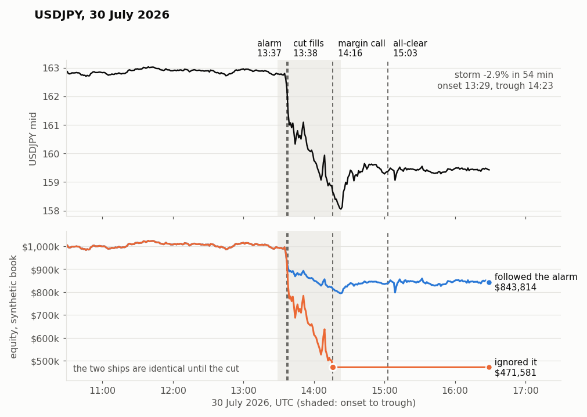

# StormScore

**A storm defence for FX traders, shown as a live 3D sea.** StormScore replays a real storm from SGX's one-minute FX data: the sea and sky turn, an alarm fires, and two ships (one followed the alarm, one ignored it) show what the warning saved, followed by a short storm report whose every number is checked by code. It is built for SGX FX's **Challenge 1, "Cloudy with a chance of margin calls"**: warn a trader before leverage turns a fast move into a margin call. It also answers **Challenge 2, "Every trader needs to start somewhere"**: *Survive the storm* is a game where a beginner picks a leverage and sails the same storm, and learns where the margin-call line sits.



## What the data showed

Two months of SGX one-minute bars (1 July to 31 August 2026; EURUSD, USDJPY, USDSGD) hold 13 storms, defined in [docs/metrics.md](docs/metrics.md). **Storms arrive without warning in prices.** `scripts/no_warning_check.py` measures volatility, spread and forward points in the 90 minutes before each storm and ranks them against normal windows of the same pair at the same time of day (full method and per-storm table in [docs/no_warning_check.md](docs/no_warning_check.md)):

- **Volatility** in the 90 minutes before onset was above the 95th percentile of normal for **1 of 13** storms (chance alone gives about 0.65 of 13); the median storm sat at the 66.7th percentile. The one exception is the 3 August USDJPY storm, which began in the first hours after the Sunday-evening open.
- **Spread** was above the 95th percentile for **3 of 13**: that same storm, and the EURUSD and USDSGD storms of 2 July, whose pre-window leads into the 12:30 US payrolls release. Spreads widen ahead of a release that is already on the calendar. That is the calendar's warning, not a price signal.
- **Forward points** (1W, 1M, 3M) were above the 95th percentile for 1, 2 and 0 of 13 storms.
- Measured from `first_onset` instead (the stricter test: the 90 minutes before it hold none of the storm), volatility is again above the 95th percentile for 1 of 13.

Whether a storm was **scheduled** is a different question, and the answer is mostly yes. A storm is scheduled when its onset is within 15 minutes of a release in [contracts/calendar.csv](contracts/calendar.csv):

<!-- metrics-table: -->
| metric | `value` | meaning |
|---|---|---|
| `by_kind.all_months.combined.storms` | 13 | storms in July and August |
| `by_kind.all_months.scheduled.storms` | 9 | onset within 15 min of a calendar release |
| `by_kind.all_months.unscheduled.v1.storms` | 4 | no release nearby |

Hence three defences, and no price predictions, ever:

1. **Warn ahead** for scheduled events, from the calendar: a watch opens 30 minutes before a release.
2. **Alarm in the first minutes** of unscheduled ones: the detector fires once the move is under way, with most of it still ahead.
3. **Prepare the book**: exposure, margin buffer and stress tests, so the cut is already decided when the alarm sounds.

## Results on August (which tuning never saw)

The alarm was tuned on July only. August, 6 storms, is the test split. Every metric below is named exactly as in `data/processed/metrics.json` and defined in [docs/metrics.md](docs/metrics.md). `v1` is the shipped detector; `naive` alarms on the first minute the 15-minute move already exceeds the storm threshold (the labelling rule itself). `caught` means at least 50% of the onset-to-trough move was still ahead when the alarm fired. Six storms is a small sample: one storm moves a share by 17 points.

**Alarm** (direction-agnostic, scored on the pair of each storm):

<!-- metrics-table: methods.{col}. -->
| metric | `v1` | `naive` | meaning |
|---|---|---|---|
| `storms` | 6 | 6 | labelled storms in August |
| `alarmed` | 6 | 6 | storms with a matching storm-level alarm |
| `caught` | 4 | 1 | alarm with at least 50% of the move still ahead |
| `median_move_ahead_pct` | 57.4 | 6.2 | % of the move still ahead at the alarm, vs onset |
| `median_minutes_to_alarm` | 3.5 | 13.0 | minutes after onset, vs onset |
| `caught_first_onset` | 4 | 1 | `caught`, measured from first_onset |
| `median_move_ahead_pct_first_onset` | 57.6 | 6.3 | % ahead, vs first_onset |
| `median_minutes_to_alarm_first_onset` | 9.0 | 15.0 | minutes after first_onset |
| `days` | 21.52 | 21.52 | observed days (1,440 minutes with a bar on any pair) |
| `false_alarms` | 11 | 0 | pair alarms outside every storm's window |
| `false_alarms_per_day` | 0.51 | 0.0 | pair alarms per observed day: USDJPY and USDSGD alarming together count twice |
| `false_alarm_episodes` | 7 | 0 | the same alarms, grouped when within 15 min of an episode's first |
| `false_alarm_episodes_per_day` | 0.33 | 0.0 | distinct alert episodes per observed day |

The naive baseline has no false alarms because it can only fire once a storm is already there; it is a ruler for lateness, not a competitor. Onset is the start of the storm's strongest 15-minute window, which is known only in hindsight, so `first_onset` is reported next to it.

**Watch and coverage** (the calendar defence):

<!-- metrics-table: -->
| metric | `value` | meaning |
|---|---|---|
| `watch_precision` | 0.29 | releases whose watch window held a storm / all releases |
| `watch.august.releases` | 7 | calendar releases in August |
| `watch.august.with_storm` | 2 | releases with a storm onset in their watch window |
| `watch.august.quiet` | 5 | quiet watches |
| `by_kind.test.scheduled.storms` | 4 | scheduled storms in August |
| `by_kind.test.scheduled.watched_before_onset` | 4 | of them, watched before onset |
| `by_kind.test.scheduled.median_warning_minutes` | 28.5 | minutes from first watch minute to onset |
| `by_kind.test.scheduled.min_warning_minutes` | 20 | the shortest warning |
| `by_kind.test.combined.storms` | 6 | all August storms |
| `by_kind.test.combined.covered` | 6 | watched before onset, or caught |
| `by_kind.test.combined.covered_pct` | 100.0 | coverage, % |

Watch precision is low, and we say so: 5 of 7 August releases passed without a storm, so a watch means "be ready", not "a storm is coming".

**Policy backtest** (synthetic three-pair book, $1,000,000 equity, 2 to 31 August; the prepared ship cuts 75% at each alarm and restores at the all-clear, filling at the next bar's open on the bid or ask):

<!-- metrics-table: policy.{col}. -->
| metric | `prepared` | `unprepared` | meaning |
|---|---|---|---|
| `final_equity_usd` | $1,033,659 | $993,889 | USD |
| `max_drawdown_usd` | $191,261 | $226,151 | largest fall from a running peak |
| `max_drawdown_pct` | 17.2 | 20.6 | %, maximised on its own, so it can come from a different peak |
| `margin_calls` | 0 | 0 | neither book was closed out in August |
| `cuts` | 11 | 0 | one per danger alarm |
| `restores` | 11 | 0 | one per all-clear |
| `fills` | 22 | 0 | cuts and restores |
| `spread_cost_usd` | $7,038 | $0 | fills' cost against mid, USD |

The defence costs spread and shows up as a shallower drawdown, not as a margin call avoided: one month, one invented book. It is a demonstration of the mechanism, not a performance claim.

### The 30 July case (July: the tuning month, so in-sample)

USDJPY fell 2.9% in 54 minutes (13:29 to 14:23 UTC) with no scheduled release nearby (the FOMC decision was 19 hours earlier). The alarm fired at 13:37, 8 minutes after onset, with 89.0% of the move still ahead. The prepared ship's cut filled at the 13:38 open bid, 162.263, and its restore at the 15:04 open ask, 159.379. The ship that ignored the alarm was closed out at 14:16.

| | Final equity | |
|---|---|---|
| Followed the alarm | $843,814 | lost $156,186, not zero: a defence, not a profit |
| Ignored it | $471,581 | margin call at 14:16 |

The prepared ship ended $372,233 ahead. The figure above is drawn by `scripts/make_figure.py` from the bundle; the minute-by-minute working is in [docs/metrics.md](docs/metrics.md) section 9.

## The replay

The 3D scene is driven by bundle fields, nothing is decoration; [web/README.md](web/README.md) has the full table. In short:

| You see or hear | It means |
|---|---|
| Wave height and chop | volatility against its trailing 24 h level (`vol_ratio`) |
| Sky darkness, cloud, fog, rain | the risk score (0 to 1) |
| Wind, rain slant | state: calm, watch, storm |
| Lightning and thunder | a one-minute move of at least 6 times normal |
| A front on the horizon, labelled "US Employment Situation in 12 min" | a watch for a scheduled release, closing in until the release |
| Lighthouse lamp and beam; foghorn and a voice, "Storm warning" | the storm alarm, until the all-clear |
| Amber flash | a squall: danger below storm level, no trade |
| Crates thrown overboard (splash); hoisted back | the prepared ship cuts 75%, then restores |
| Ship heels, rides lower, sinks (and the "Margin call" voice) | equity falling, the margin buffer shrinking, a margin call |
| Sun breaks through, sails fill | a fair wind: a storm-level move in the book's favour, no trade |
| Night lanterns, "market closed" badge | the NVDA replay's closed hours |
| Calm, tense, stormy music bed, and a soft note per market minute | state, and the price: higher price, higher pitch |

**Survive the storm** is for beginners: choose a storm and a leverage from 1x to 30x, see where the margin-call line sits on the chart, press Sail, and cut (C) or restore (R) as the same alarm sounds. A margin call sinks the ship. The end card explains in plain words what a 1% move does to your equity at that leverage, and what holding, or cutting at the alarm, would have done. Its equity uses the same book accounting as the backend, checked against it in 80 cases with no difference in equity, notional or margin-call frame.

## The AI crew

**Models read, code judges.** Code checks every number an AI writes, and a deterministic template takes over when a check fails.

| Role | What it does | Where |
|---|---|---|
| **Code detector** | Decides every alarm, watch and all-clear from the data. No model | `storm.detector` |
| **Navigator** | Answers what-if questions ("what if USDJPY drops 3% in 30 minutes?") by calling deterministic tools (`scenario`, `stress_test`, `get_exposure`, `list_storms`) and returns a replayable what-if bundle | `storm.ai.navigator` |
| **Radio officer** | Writes the three-or-four-sentence storm report from facts computed in code | `storm.ai.report` |
| **Inspector** | Audits every report and answer for wrong associations and invented causes. It is a **different model family** from the writer | `storm.ai.inspector` |
| **Quartermaster** | The budget guard: a ledger and caps; warns at 75% of a provider's cap and refuses at 90% | `storm.ai.budget` |

Every number a model writes is extracted and must equal a fact the code computed from the bundle, exactly, or that fact rounded at the precision written. A failed check gets one correction attempt with the bad numbers; after that the report is a deterministic four-sentence template. The inspector's flag also sends a report to the template. Everything goes through one gateway, `storm.ai.llm.complete()`, which is mock unless a call is explicitly live. Details in [backend/storm/ai/README.md](backend/storm/ai/README.md).

**The writer bake-off** (14 November 2026; 15 local bundles: 13 SGX storms, the NVDA storm and the synthetic mock; from [backend/reports/bakeoff.md](backend/reports/bakeoff.md)):

| Writer | Inspector | Reports done | Errors | First-try verified | Inspector flags | Template fallbacks | Mean latency | Cost / report |
|---|---|---|---|---|---|---|---|---|
| muse-spark-1.3 (Meta) | kimi-k3p1-pro | 15 / 15 | 0 | 93% (14/15) | 0 | 0 | 13.2 s | $0.0156 |
| deepseek-v4p1-flash (Fireworks) | kimi-k3p1-pro | 15 / 15 | 0 | 100% (15/15) | 1 | 1 | 15.6 s | $0.0412\* |
| kimi-k3p1-pro (Fireworks) | deepseek-v4p1-flash | 11 / 15 | 4 | 33% (5/15) | 1 | 3 | 20.4 s | $0.0398\* |

\* Overstated: the price table lacked those Fireworks IDs, so they were charged at the fallback rate. All four Kimi errors were reasoning-budget exhaustion. Its inspector differs from the other rows. **muse-spark-1.3 is the writer**: no errors, no flags, no fallbacks, fastest and cheapest.

**Private mode on Modal.** With `LLM_PRIVATE_MODE=1` every live role, the inspector included, runs on one deployment of public Qwen3-8B weights on Modal, and no external model provider is called. The measured trade-off ([tools/modal/validation.json](tools/modal/validation.json), 13 SGX FX bundles, an L40S because L4 and A10G had no capacity):

| | Qwen3-8B on Modal | muse-spark-1.3 (table above) |
|---|---|---|
| First-try numeric verification | 61.5% (8 of 13) | 93% (14 of 15) |
| Template fallbacks | 9 of 13 | 0 of 15 |
| Inspector flags | 4 | 0 |
| Mean latency per report | 12.4 s (writer alone 8.7 s) | 13.2 s |
| Cold start from zero runners | 55.1 s | none |
| GPU allocation observed in the 27-minute test window | 14.6 GPU-minutes | none |

The privacy is real and the quality is lower: most reports fall back to the template. Because code still checks every number, the loss shows as plainer text, never as wrong figures. In this comparison the inspector was Kimi on Fireworks, so it is **not** private mode; it is the writer comparison. A second sample of the same run (13 bundles) had 11 fallbacks, 7 flags and 2 reports accepted first time ([tools/modal/review_bakeoff.json](tools/modal/review_bakeoff.json)): Qwen's text is a stochastic result, and the template is why that is safe. Run entirely private, one report took 12.6 s (it fell back to the template, which is verified) and one navigator answer 4.8 s (verified).

## Data stack

**Tiger Data (TimescaleDB).** SGX's bars are loaded into two hypertables, `spot_1m` and `forward_1m`, with 7-day chunks, compressed by series. Two continuous aggregates, `candles_5m` and `vol_1h`, serve the chart. Measured on 14 November against the live database ([docs/tiger_stats.json](docs/tiger_stats.json)):

| | |
|---|---|
| Rows | 193,049 spot, 1,661,187 forward |
| Size before and after compression | 316,563,456 bytes to 42,950,656 bytes, a ratio of 7.37 |
| `/api/candles`: 72 five-minute candles for 6 hours of USDJPY | median 21.5 ms over six calls (19.8 to 42.9 ms), including the network round trip |

The web app works without it; with it, the HUD shows "Live · Tiger Data" and the chart's candles come from the database. See [backend/storm/live/README.md](backend/storm/live/README.md).

**ElevenLabs.** 19 sounds, generated once by `tools/audio/generate.py` and committed (`web/public/audio/`): five ambience loops (calm and rough sea, wind, rain, storm), eight one-shots (three thunders, foghorn, splash, creak, sinking, bell), three music beds and three stock-voice lines. The browser mixes them by risk and state. The **price melody is not a recording**: it is synthesised live in the browser with Tone.js, one soft note per market minute on a C-minor pentatonic scale, pitch following the price. See [web/src/audio/README.md](web/src/audio/README.md).

## Honesty notes

- **The trader book is synthetic** and labelled so everywhere: long USD 20,000,000 on $1,000,000 equity for one pair (2.5% maintenance), three equal legs in the backtest. No personal data is used.
- **The event calendar was assembled after seeing the storm list.** It lists 12 verified releases from public sources: the BLS release schedules for [July](https://www.bls.gov/schedule/2026/07_sched_list.htm) and [August](https://www.bls.gov/schedule/2026/08_sched_list.htm), and the Federal Reserve's [FOMC calendar](https://www.federalreserve.gov/monetarypolicy/fomccalendars.htm) and [August 2026 events](https://www.federalreserve.gov/newsevents/2026-august.htm). Release times are published in advance, so a watch built from them uses nothing a trader did not already have. A scheduled label states timing only; it does not claim the release caused the move.
- **Onset is defined in hindsight** (the strongest 15-minute window), so `first_onset` is reported next to it everywhere.
- **July is in-sample.** The detector was tuned on July; only August is a test, and six storms is small.
- **The NVDA case** (11 to 12 November) uses Yahoo Finance one-minute trade bars, which have trades but no quotes, so no spread is measured. Its report states market facts only: a fall of 14.4% from the 11 November close to the 12 November low, over 572 trading minutes, and it names no cause.
- **An independent review by another model family found 15 issues** in the backend (execution timing, margin order, causality of bad prints, calendar rules, stress tests, rounding, false-alarm counting, provenance). All 15 are fixed, each with tests, in [backend/tests/test_audit.py](backend/tests/test_audit.py).
- **Never a price prediction.** The detector says a storm is under way, and the calendar says one may be near.

## How to run

You need Python 3.10 and Node (built and run here with Node 24). The demo script is:

```bash
pip install -r backend/requirements.txt      # a venv is recommended
cd web && npm install && cd ..
scripts/demo.sh                              # LIVE=1 scripts/demo.sh for real model calls
```

`scripts/demo.sh` starts the live API on :8000 if `.env` has `TIGER_DATABASE_URL`, then the web dev server, prints the URL to open (http://localhost:5173/) and stops both on Ctrl+C. It works from any checkout whose root has the `.env` (a symlink is fine), and with `LIVE=1` it sets `LLM_MODE=live`. Copy `.env.example` to `.env`; keys stay local and are never committed. Live model calls also need provider caps in `~/.stormscore/caps.json` (see `caps.example.json`).

**What works without SGX's data:** the synthetic **mock storm** replay (`contracts/mock_storm.json`, committed, labelled synthetic), Survive on it, and the backend test suite, which uses synthetic fixtures (`cd backend && python -m pytest -q`). **What needs SGX's data** (not redistributed here; place the zips in `data/raw/`): the real storms, the metrics and the figure:

```bash
cd backend
python -m storm.ingest && python -m storm.labels && python -m storm.tune && python -m storm.backtest
python -m storm.export --all                 # writes web/public/bundles/ (gitignored)
python -m storm.live.tiger --load            # optional: load Tiger Data
python ../scripts/no_warning_check.py        # the "no warning in prices" check
python ../scripts/make_figure.py             # needs matplotlib
```

The README's results tables are tested against `data/processed/metrics.json`; `scripts/readme_results.py` prints the check.

## Repo map

| Path | What |
|---|---|
| `backend/storm/` | labels, features, detector, evaluation, backtest, exposure and equity simulators, bundle export |
| `backend/storm/ai/` | the model gateway, budget guard, navigator, report writer, inspector, verifier |
| `backend/storm/live/` | the Tiger Data loader and FastAPI live API |
| `backend/tests/` | the test suite (synthetic data), including the audit and README-results tests |
| `contracts/` | the replay bundle and API contracts, the event calendar, the synthetic mock storm |
| `web/` | the 3D replay and Survive game (React, three.js); `web/src/audio/` is the sound engine |
| `tools/audio/`, `tools/modal/` | ElevenLabs asset generation; the private GPU crew on Modal |
| `scripts/` | `demo.sh`, `make_figure.py`, `no_warning_check.py`, `readme_results.py` |
| `docs/` | metric definitions, the saved no-warning check, the figure, Tiger stats |
| `data/` | SGX data and derived files (gitignored, not redistributed) |

## Built with

SGX one-minute FX data · React, three.js and react-three-fiber, Vite, zustand · [TradingView Lightweight Charts](https://www.tradingview.com/lightweight-charts/) (Apache-2.0; the attribution logo is kept on) · Tone.js · ElevenLabs · Tiger Data (TimescaleDB), FastAPI, psycopg · pandas, NumPy · Meta Muse, Fireworks (Kimi, DeepSeek) and Modal (Qwen3-8B) for the AI crew · Yahoo Finance via yfinance for the NVDA case · matplotlib for the figure.

## Team

TBC
