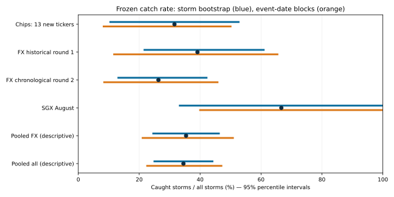
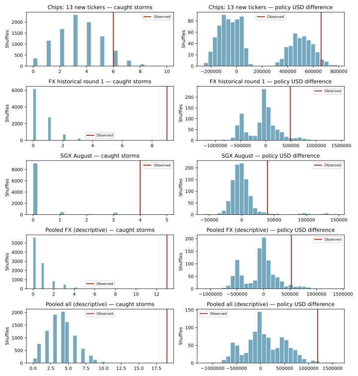

# Frozen statistical evidence

On SGX's August test month the frozen detector caught 4 of 6 storms, with a storm-bootstrap 95% interval of 33.3% to 100.0%; that is a small sample.
On the selected historical FX windows it caught 9 of 23, with timing-randomization p=0.0001, but these events were chosen for stress rather than sampled prospectively.
On the thirteen new chip tickers it caught 6 of 19; their shared dates, sector and already seen shock week weaken independence.
The descriptive pooled catch rate is 39.6%, with a joint-date-block 95% interval of 24.5% to 55.3%; pooling does not create a new holdout.
False-alert burden was 0.33 episodes per observed day on SGX and 1.75 per trading day on chips (2.65 per observed day).
The synthetic prepared books' pooled FX result was USD 527,056 relative to holding, but 0 of 3 individual dataset policy tests survived multiplicity correction.
At five-bar fills, SGX's simulated policy advantage changes from USD 39,770 to USD -10,269, so the benefit is sensitive to execution delay.
Round-two status is pending; monitor until registered cutoff; this retrospective evidence supports assessment of detection and risk response, and does not demonstrate price prediction or causal trading profit.

## Frozen headline and uncertainty

Secondary retrospective analysis. The headline configuration is fixed throughout. Brackets are percentile 95% intervals from 10,000 resamples; conditional medians use alarmed storms only. Shares use all storms, including misses. Negative minutes mean an alarm before the strongest-window onset.

| Dataset | Storms | Alarmed share [95%] | Caught share [95%] | Median share ahead, % [95%] | Median minutes to alarm [95%] | False episodes / observed day [95%] |
|---|---:|---|---|---|---|---|
| Chips: 13 new tickers | 19 | 84.2% [68.4%, 100.0%] | 31.6% [10.5%, 52.6%] | 25.21 [7.84, 57.81] | 10.00 [5.00, 12.00] | 2.65 [1.89, 3.48] |
| FX historical round 1 | 23 | 82.6% [65.2%, 95.7%] | 39.1% [21.7%, 60.9%] | 43.40 [35.18, 69.59] | 5.00 [2.00, 10.00] | 0.22 [0.11, 0.33] |
| SGX August | 6 | 100.0% [100.0%, 100.0%] | 66.7% [33.3%, 100.0%] | 57.39 [32.04, 80.27] | 3.50 [1.00, 11.00] | 0.33 [0.10, 0.61] |
| Pooled FX (descriptive) | 29 | 86.2% [72.4%, 96.6%] | 44.8% [27.6%, 62.1%] | 55.51 [35.18, 66.50] | 4.00 [2.00, 10.00] | 0.24 [0.15, 0.35] |
| Pooled all (descriptive) | 48 | 85.4% [75.0%, 93.8%] | 39.6% [27.1%, 54.2%] | 43.40 [33.58, 57.98] | 8.00 [4.00, 10.00] | 0.56 [0.42, 0.72] |

Storm resampling assumes independent storms; the date-block intervals below jointly resample storms across pairs on the same event date. They remain weak with few independent event dates. An all-success sample produces a degenerate empirical bootstrap interval (SGX alarmed share is 100% to 100%); that cannot establish perfect population sensitivity or account for misses absent from the sample. Dataset strata and their actual storm counts are retained in pooled resamples. False-alert intervals resample whole days jointly across pairs, including zero-alarm and partial days; unrelated historical windows are separate timelines.

| Dataset | Event-date blocks | Alarmed share, date-block [95%] | Caught share, date-block [95%] | Caught share, first onset [95%] | First-onset median minutes [95%] | Undefined conditional-median replicates |
|---|---:|---|---|---|---|---:|
| Chips: 13 new tickers | 9 | 84.2% [72.7%, 94.7%] | 31.6% [8.3%, 50.0%] | 36.8% [15.8%, 57.9%] | 14.00 [12.00, 16.00] | 0 |
| FX historical round 1 | 16 | 82.6% [61.9%, 96.3%] | 39.1% [11.8%, 65.4%] | 39.1% [21.7%, 60.9%] | 14.00 [7.00, 16.00] | 0 |
| SGX August | 4 | 100.0% [100.0%, 100.0%] | 66.7% [40.0%, 100.0%] | 66.7% [33.3%, 100.0%] | 9.00 [1.50, 14.00] | 0 |
| Pooled FX (descriptive) | 20 | 86.2% [70.4%, 97.0%] | 44.8% [24.0%, 66.7%] | 44.8% [27.6%, 62.1%] | 14.00 [6.50, 15.00] | 0 |
| Pooled all (descriptive) | 29 | 85.4% [75.0%, 93.8%] | 39.6% [24.5%, 55.3%] | 41.7% [29.2%, 56.2%] | 14.00 [12.00, 15.00] | 0 |

Chips additionally retains the original ET trading-day denominator: 1.75 [1.25, 2.30] false episodes per trading day, over 20 dates. Observed days mean 1,440 union observed minutes; the two rates are not interchangeable. NVDA is excluded from every headline and pooled row. Its original in-sample and all-ticker descriptive splits remain in results.json.



## Against chance

The null uniformly translates each complete pair/window alarm train over feasible integer-minute offsets, preserving alarm count, clock duration and within-pair timing. It rejects boundary-crossing episodes, undefined/off-market alarm starts and unobserved closed endpoints. Detection and danger trains share offsets; pairs move independently. Book-danger labels travel with the alarms and are not reclassified from prices at the new time: the policy null tests the observed direction-and-timing schedule, rather than timing conditional on an adverse price move. Open episodes retain administrative observed duration and schedule no invented restore. Feasible offset counts and their hashes, sampled offsets, full null arrays, per-storm hit arrays and oracle checks are retained under nulls/ and units/.

One-sided Monte Carlo p=(1+null values at least observed)/(B+1). Detection uses 10,000 draws; policy uses the same first 1,000 draws and full execution/margin paths. Holm adjustment covers both primary tests across the available individual datasets; pooled tests are descriptive and excluded from this family. This is a conditional timing null, not a causal randomization, a uniform distribution over all possible alarm schedules, or a deployable random-trader benchmark. Independent pair shifts remove cross-pair timing dependence. Duration conditioning and sparse feasible offsets can limit power.

| Dataset | Statistic | Observed | Null median [2.5%, 97.5%] | B | Exceedances | Raw p | Holm p | Monte Carlo SE | Degenerate |
|---|---|---:|---|---:|---:|---:|---:|---:|---|
| Chips: 13 new tickers | Caught storms | 6 | 3 [0, 7] | 10000 | 1080 | 0.1081 | 0.1439 | 0.0031 | False |
| Chips: 13 new tickers | Prepared − unprepared, USD | 660,809 | 26,759 [-194,002, 648,151] | 1000 | 23 | 0.0240 | 0.0959 | 0.0048 | False |
| FX historical round 1 | Caught storms | 9 | 0 [0, 3] | 10000 | 0 | 0.0001 | 0.0006 | 0.0001 | False |
| FX historical round 1 | Prepared − unprepared, USD | 487,286 | -27,625 [-605,997, 651,932] | 1000 | 47 | 0.0480 | 0.1439 | 0.0068 | False |
| SGX August | Caught storms | 4 | 0 [0, 3] | 10000 | 5 | 0.0006 | 0.0030 | 0.0002 | False |
| SGX August | Prepared − unprepared, USD | 39,770 | -1,796 [-24,215, 95,905] | 1000 | 48 | 0.0490 | 0.1439 | 0.0068 | False |
| Pooled FX (descriptive) | Caught storms | 13 | 0 [0, 3] | 10000 | 0 | 0.0001 | undefined | 0.0001 | False |
| Pooled FX (descriptive) | Prepared − unprepared, USD | 527,056 | -24,454 [-603,251, 656,452] | 1000 | 42 | 0.0430 | undefined | 0.0064 | False |
| Pooled all (descriptive) | Caught storms | 19 | 4 [1, 8] | 10000 | 0 | 0.0001 | undefined | 0.0001 | False |
| Pooled all (descriptive) | Prepared − unprepared, USD | 1,187,865 | 29,140 [-651,262, 911,430] | 1000 | 7 | 0.0080 | undefined | 0.0028 | False |



## Naive and v0 on identical features

These are detection baselines, not retrofitted trading policies. Paired intervals resample the same storm indices for v1 and each baseline. Naive waits for the label-sized 15-minute price move; v0 uses its unchanged hand-set settings. Baselines retain their existing gap/session behavior, so chip comparisons inherit that implementation's limitations.

| Dataset | Baseline | Alarmed / storms | Caught / storms | False episodes / observed day | v1 − baseline caught share [95%] |
|---|---|---:|---:|---:|---|
| Chips: 13 new tickers | naive | 17 / 19 | 2 / 19 | 0.45 | 21.1% [-5.3%, 47.4%] |
| Chips: 13 new tickers | v0 | 17 / 19 | 10 / 19 | 6.20 | -21.1% [-42.1%, 0.0%] |
| FX historical round 1 | naive | 22 / 23 | 6 / 23 | 0.02 | 13.0% [-4.3%, 30.4%] |
| FX historical round 1 | v0 | 22 / 23 | 13 / 23 | 1.50 | -17.4% [-34.8%, -4.3%] |
| SGX August | naive | 6 / 6 | 1 / 6 | 0.00 | 50.0% [16.7%, 83.3%] |
| SGX August | v0 | 6 / 6 | 4 / 6 | 1.86 | 0.0% [0.0%, 0.0%] |
| Pooled FX (descriptive) | naive | 28 / 29 | 7 / 29 | 0.01 | 20.7% [3.4%, 37.9%] |
| Pooled FX (descriptive) | v0 | 28 / 29 | 17 / 29 | 1.59 | -13.8% [-27.6%, -3.4%] |
| Pooled all (descriptive) | naive | 45 / 48 | 9 / 48 | 0.07 | 20.8% [6.2%, 35.4%] |
| Pooled all (descriptive) | v0 | 45 / 48 | 27 / 48 | 2.20 | -16.7% [-29.2%, -4.2%] |

### Conditional timing design

| Independent window | Instrument | Detection alarms | Danger alarms | Feasible minute offsets | Administratively censored detection episodes |
|---|---|---:|---:|---:|---:|
| sgx-august | EURUSD | 4 | 2 | 8798 | 0 |
| sgx-august | USDJPY | 8 | 5 | 1806 | 0 |
| sgx-august | USDSGD | 5 | 4 | 8559 | 0 |
| snb-2015 | EURCHF | 1 | 0 | 5231 | 0 |
| snb-2015 | USDCHF | 2 | 2 | 5314 | 0 |
| gbp-flash-2016 | GBPUSD | 1 | 1 | 4103 | 0 |
| jpy-flash-2019 | USDJPY | 1 | 1 | 4202 | 0 |
| jpy-flash-2019 | AUDJPY | 1 | 0 | 4242 | 0 |
| intervention-sep-2022 | USDJPY | 3 | 3 | 4887 | 0 |
| intervention-oct-2022 | USDJPY | 2 | 2 | 2266 | 0 |
| carry-2024 | USDJPY | 1 | 1 | 7063 | 0 |
| ordinary-mar-2024 | EURUSD | 7 | 5 | 2490 | 0 |
| ordinary-mar-2024 | USDJPY | 6 | 5 | 3940 | 0 |
| ordinary-mar-2024 | GBPUSD | 4 | 3 | 7044 | 0 |
| ordinary-jun-2025 | EURUSD | 3 | 3 | 13437 | 0 |
| ordinary-jun-2025 | USDJPY | 4 | 4 | 15072 | 0 |
| ordinary-jun-2025 | GBPUSD | 2 | 2 | 16199 | 0 |
| chips-new-tickers | AMD | 5 | 1 | 108 | 0 |
| chips-new-tickers | AVGO | 4 | 0 | 18 | 1 |
| chips-new-tickers | TSM | 11 | 2 | 2 | 0 |
| chips-new-tickers | MU | 7 | 3 | 99 | 0 |
| chips-new-tickers | ARM | 2 | 1 | 1015 | 0 |
| chips-new-tickers | SMCI | 6 | 1 | 17 | 0 |
| chips-new-tickers | INTC | 5 | 1 | 594 | 0 |
| chips-new-tickers | QCOM | 2 | 1 | 362 | 0 |
| chips-new-tickers | MRVL | 4 | 1 | 40 | 0 |
| chips-new-tickers | AMAT | 2 | 0 | 1058 | 0 |
| chips-new-tickers | LRCX | 2 | 1 | 290 | 0 |
| chips-new-tickers | SMH | 4 | 1 | 31 | 0 |
| chips-new-tickers | SOXX | 9 | 1 | 3 | 0 |

## Synthetic policy outcomes

Current-main policy is frozen at the registered base, without tuning. FX books start with USD 1m equity, 20x total gross exposure, 2.5% maintenance; chip secondary books are independent long-stock books per new ticker, 4x exposure and 15% maintenance. All cut 75% on book-danger alarms and restore at all-clear, filling next observed open. Non-USD crosses without a registered conversion leg are excluded from policy only. Round two retains its usable independent weekly reset books and carry-in convention. Policy sums across reset books are scenario totals, not the return of one investable portfolio. Maximum book drawdown is the worst individual reset book, not an aggregate portfolio drawdown.

| Dataset | Reset books | Prepared − unprepared, USD | Prepared P&L, USD | Holding P&L, USD | Prepared / holding margin calls | Prepared / holding spread cost, USD | Worst prepared / holding book drawdown, USD |
|---|---:|---:|---:|---:|---|---|---|
| Chips: 13 new tickers | 13 | 660,809 | -7,824,243 | -8,485,052 | 12 / 13 | 0 / 0 | 2,820,442 / 2,878,468 |
| FX historical round 1 | 8 | 487,286 | -1,143,179 | -1,630,466 | 3 / 3 | 79,470 / 56,479 | 827,332 / 855,330 |
| SGX August | 1 | 39,770 | 33,659 | -6,111 | 0 / 0 | 7,038 / 0 | 191,261 / 226,151 |
| Pooled FX (descriptive) | 9 | 527,056 | -1,109,520 | -1,636,576 | 3 / 3 | 86,507 / 56,479 | 827,332 / 855,330 |
| Pooled all (descriptive) | 22 | 1,187,865 | -8,933,763 | -10,121,628 | 15 / 16 | 86,507 / 56,479 | 2,820,442 / 2,878,468 |

Round 1's published policy used an older valuation implementation. Original per-window policy results are preserved beside current-main recomputation in units/; they are not silently revised. Chip full-period policies here are new secondary analyses, rather than the original selected replay outcomes. Yahoo bars contain trades, not measured quotes: zero simulated spread is not evidence of free execution, and spread sensitivities are unavailable for chips.

| Dataset | Published prepared − holding, USD | Frozen-main prepared − holding, USD |
|---|---:|---:|
| SGX August | 39,770 | 39,770 |
| FX historical round 1 | 487,286 | 487,286 |

## Sensitivity beside the frozen headline

Every row changes one factor only. There is no search, selection or replacement of the headline. Invalid storm_on=0.70 remains invalid because frozen squall_on=0.75 would exceed it. Fill delays count observed traded bars after the signal and apply to cuts and restores. Leverage 10x/20x/30x is an additional stress for chip books whose headline is 4x; unchanged 15% maintenance can force immediate liquidation. No sensitivity p-values were run and headline null distributions are not reused to infer significance for a changed policy.

### Chips: 13 new tickers

| Setting | Status | Caught / storms | Alarmed share | False episodes / observed day | Prepared − unprepared, USD | Prepared / holding margin calls | Policy-sign conclusion survives | Catch-advantage sign vs naive survives |
|---|---|---:|---:|---:|---:|---|---|---|
| **Frozen headline** | fixed | 6 / 19 | 84.2% | 2.65 | 660,809 | 12 / 13 | reference | reference |
| spread_multiplier=1 | unavailable: Yahoo trade bars have no measured bid/ask spread; 1x/2x/3x cannot be priced. | — | — | — | — | — | — | — |
| spread_multiplier=2 | unavailable: Yahoo trade bars have no measured bid/ask spread; 1x/2x/3x cannot be priced. | — | — | — | — | — | — | — |
| spread_multiplier=3 | unavailable: Yahoo trade bars have no measured bid/ask spread; 1x/2x/3x cannot be priced. | — | — | — | — | — | — | — |
| fill_delay_bars=1 | evaluated | 6 / 19 | 84.2% | 2.65 | 660,809 | 12 / 13 | True | True |
| fill_delay_bars=2 | evaluated | 6 / 19 | 84.2% | 2.65 | 608,946 | 12 / 13 | True | True |
| fill_delay_bars=5 | evaluated | 6 / 19 | 84.2% | 2.65 | 575,271 | 12 / 13 | True | True |
| cut_fraction=0.5 | evaluated | 6 / 19 | 84.2% | 2.65 | 569,579 | 12 / 13 | True | True |
| cut_fraction=0.75 | evaluated | 6 / 19 | 84.2% | 2.65 | 660,809 | 12 / 13 | True | True |
| cut_fraction=1.0 | evaluated | 6 / 19 | 84.2% | 2.65 | 752,243 | 12 / 13 | True | True |
| leverage=10 | evaluated | 6 / 19 | 84.2% | 2.65 | 0 | 13 / 13 | False | True |
| leverage=20 | evaluated | 6 / 19 | 84.2% | 2.65 | 0 | 13 / 13 | False | True |
| leverage=30 | evaluated | 6 / 19 | 84.2% | 2.65 | 0 | 13 / 13 | False | True |
| storm_on=0.7 | invalid: Frozen ordering requires squall_on=0.75 <= storm_on; no other threshold changed. | — | — | — | — | — | — | — |
| storm_on=0.8 | evaluated | 6 / 19 | 84.2% | 2.65 | 660,809 | 12 / 13 | True | True |
| storm_on=0.9 | evaluated | 4 / 19 | 78.9% | 1.82 | 584,818 | 12 / 13 | True | True |

### FX historical round 1

| Setting | Status | Caught / storms | Alarmed share | False episodes / observed day | Prepared − unprepared, USD | Prepared / holding margin calls | Policy-sign conclusion survives | Catch-advantage sign vs naive survives |
|---|---|---:|---:|---:|---:|---|---|---|
| **Frozen headline** | fixed | 9 / 23 | 82.6% | 0.22 | 487,286 | 3 / 3 | reference | reference |
| spread_multiplier=1 | evaluated | 9 / 23 | 82.6% | 0.22 | 487,286 | 3 / 3 | True | True |
| spread_multiplier=2 | evaluated | 9 / 23 | 82.6% | 0.22 | 464,269 | 3 / 3 | True | True |
| spread_multiplier=3 | evaluated | 9 / 23 | 82.6% | 0.22 | 441,252 | 3 / 3 | True | True |
| fill_delay_bars=1 | evaluated | 9 / 23 | 82.6% | 0.22 | 487,286 | 3 / 3 | True | True |
| fill_delay_bars=2 | evaluated | 9 / 23 | 82.6% | 0.22 | 540,240 | 3 / 3 | True | True |
| fill_delay_bars=5 | evaluated | 9 / 23 | 82.6% | 0.22 | 406,610 | 3 / 3 | True | True |
| cut_fraction=0.5 | evaluated | 9 / 23 | 82.6% | 0.22 | 324,858 | 3 / 3 | True | True |
| cut_fraction=0.75 | evaluated | 9 / 23 | 82.6% | 0.22 | 487,286 | 3 / 3 | True | True |
| cut_fraction=1.0 | evaluated | 9 / 23 | 82.6% | 0.22 | 649,715 | 3 / 3 | True | True |
| leverage=10 | evaluated | 9 / 23 | 82.6% | 0.22 | 453,295 | 1 / 1 | True | True |
| leverage=20 | evaluated | 9 / 23 | 82.6% | 0.22 | 487,286 | 3 / 3 | True | True |
| leverage=30 | evaluated | 9 / 23 | 82.6% | 0.22 | 781,294 | 6 / 7 | True | True |
| storm_on=0.7 | invalid: Frozen ordering requires squall_on=0.75 <= storm_on; no other threshold changed. | — | — | — | — | — | — | — |
| storm_on=0.8 | evaluated | 9 / 23 | 82.6% | 0.22 | 487,286 | 3 / 3 | True | True |
| storm_on=0.9 | evaluated | 8 / 23 | 82.6% | 0.11 | 411,125 | 3 / 3 | True | True |

### SGX August

| Setting | Status | Caught / storms | Alarmed share | False episodes / observed day | Prepared − unprepared, USD | Prepared / holding margin calls | Policy-sign conclusion survives | Catch-advantage sign vs naive survives |
|---|---|---:|---:|---:|---:|---|---|---|
| **Frozen headline** | fixed | 4 / 6 | 100.0% | 0.33 | 39,770 | 0 / 0 | reference | reference |
| spread_multiplier=1 | evaluated | 4 / 6 | 100.0% | 0.33 | 39,770 | 0 / 0 | True | True |
| spread_multiplier=2 | evaluated | 4 / 6 | 100.0% | 0.33 | 32,725 | 0 / 0 | True | True |
| spread_multiplier=3 | evaluated | 4 / 6 | 100.0% | 0.33 | 25,680 | 0 / 0 | True | True |
| fill_delay_bars=1 | evaluated | 4 / 6 | 100.0% | 0.33 | 39,770 | 0 / 0 | True | True |
| fill_delay_bars=2 | evaluated | 4 / 6 | 100.0% | 0.33 | 40,395 | 0 / 0 | True | True |
| fill_delay_bars=5 | evaluated | 4 / 6 | 100.0% | 0.33 | -10,269 | 0 / 0 | False | True |
| cut_fraction=0.5 | evaluated | 4 / 6 | 100.0% | 0.33 | 26,513 | 0 / 0 | True | True |
| cut_fraction=0.75 | evaluated | 4 / 6 | 100.0% | 0.33 | 39,770 | 0 / 0 | True | True |
| cut_fraction=1.0 | evaluated | 4 / 6 | 100.0% | 0.33 | 53,026 | 0 / 0 | True | True |
| leverage=10 | evaluated | 4 / 6 | 100.0% | 0.33 | 19,885 | 0 / 0 | True | True |
| leverage=20 | evaluated | 4 / 6 | 100.0% | 0.33 | 39,770 | 0 / 0 | True | True |
| leverage=30 | evaluated | 4 / 6 | 100.0% | 0.33 | 59,655 | 0 / 0 | True | True |
| storm_on=0.7 | invalid: Frozen ordering requires squall_on=0.75 <= storm_on; no other threshold changed. | — | — | — | — | — | — | — |
| storm_on=0.8 | evaluated | 4 / 6 | 100.0% | 0.33 | 39,770 | 0 / 0 | True | True |
| storm_on=0.9 | evaluated | 2 / 6 | 83.3% | 0.28 | 11,790 | 0 / 0 | True | True |

### Pooled FX (descriptive)

| Setting | Status | Caught / storms | Alarmed share | False episodes / observed day | Prepared − unprepared, USD | Prepared / holding margin calls | Policy-sign conclusion survives | Catch-advantage sign vs naive survives |
|---|---|---:|---:|---:|---:|---|---|---|
| **Frozen headline** | fixed | 13 / 29 | 86.2% | 0.24 | 527,056 | 3 / 3 | reference | reference |
| spread_multiplier=1 | evaluated | 13 / 29 | 86.2% | 0.24 | 527,056 | 3 / 3 | True | True |
| spread_multiplier=2 | evaluated | 13 / 29 | 86.2% | 0.24 | 496,994 | 3 / 3 | True | True |
| spread_multiplier=3 | evaluated | 13 / 29 | 86.2% | 0.24 | 466,933 | 3 / 3 | True | True |
| fill_delay_bars=1 | evaluated | 13 / 29 | 86.2% | 0.24 | 527,056 | 3 / 3 | True | True |
| fill_delay_bars=2 | evaluated | 13 / 29 | 86.2% | 0.24 | 580,635 | 3 / 3 | True | True |
| fill_delay_bars=5 | evaluated | 13 / 29 | 86.2% | 0.24 | 396,341 | 3 / 3 | True | True |
| cut_fraction=0.5 | evaluated | 13 / 29 | 86.2% | 0.24 | 351,371 | 3 / 3 | True | True |
| cut_fraction=0.75 | evaluated | 13 / 29 | 86.2% | 0.24 | 527,056 | 3 / 3 | True | True |
| cut_fraction=1.0 | evaluated | 13 / 29 | 86.2% | 0.24 | 702,741 | 3 / 3 | True | True |
| leverage=10 | evaluated | 13 / 29 | 86.2% | 0.24 | 473,180 | 1 / 1 | True | True |
| leverage=20 | evaluated | 13 / 29 | 86.2% | 0.24 | 527,056 | 3 / 3 | True | True |
| leverage=30 | evaluated | 13 / 29 | 86.2% | 0.24 | 840,949 | 6 / 7 | True | True |
| storm_on=0.7 | invalid: Frozen ordering requires squall_on=0.75 <= storm_on; no other threshold changed. | — | — | — | — | — | — | — |
| storm_on=0.8 | evaluated | 13 / 29 | 86.2% | 0.24 | 527,056 | 3 / 3 | True | True |
| storm_on=0.9 | evaluated | 10 / 29 | 82.8% | 0.15 | 422,914 | 3 / 3 | True | True |

### Pooled all (descriptive)

| Setting | Status | Caught / storms | Alarmed share | False episodes / observed day | Prepared − unprepared, USD | Prepared / holding margin calls | Policy-sign conclusion survives | Catch-advantage sign vs naive survives |
|---|---|---:|---:|---:|---:|---|---|---|
| **Frozen headline** | fixed | 19 / 48 | 85.4% | 0.56 | 1,187,865 | 15 / 16 | reference | reference |
| spread_multiplier=1 | partial (FX subset only) | 13 / 29 | 86.2% | 0.24 | 527,056 | 3 / 3 | True | True |
| spread_multiplier=2 | partial (FX subset only) | 13 / 29 | 86.2% | 0.24 | 496,994 | 3 / 3 | True | True |
| spread_multiplier=3 | partial (FX subset only) | 13 / 29 | 86.2% | 0.24 | 466,933 | 3 / 3 | True | True |
| fill_delay_bars=1 | evaluated | 19 / 48 | 85.4% | 0.56 | 1,187,865 | 15 / 16 | True | True |
| fill_delay_bars=2 | evaluated | 19 / 48 | 85.4% | 0.56 | 1,189,580 | 15 / 16 | True | True |
| fill_delay_bars=5 | evaluated | 19 / 48 | 85.4% | 0.56 | 971,612 | 15 / 16 | True | True |
| cut_fraction=0.5 | evaluated | 19 / 48 | 85.4% | 0.56 | 920,950 | 15 / 16 | True | True |
| cut_fraction=0.75 | evaluated | 19 / 48 | 85.4% | 0.56 | 1,187,865 | 15 / 16 | True | True |
| cut_fraction=1.0 | evaluated | 19 / 48 | 85.4% | 0.56 | 1,454,984 | 15 / 16 | True | True |
| leverage=10 | evaluated | 19 / 48 | 85.4% | 0.56 | 473,180 | 14 / 14 | True | True |
| leverage=20 | evaluated | 19 / 48 | 85.4% | 0.56 | 527,056 | 16 / 16 | True | True |
| leverage=30 | evaluated | 19 / 48 | 85.4% | 0.56 | 840,949 | 19 / 20 | True | True |
| storm_on=0.7 | invalid: Frozen ordering requires squall_on=0.75 <= storm_on; no other threshold changed. | — | — | — | — | — | — | — |
| storm_on=0.8 | evaluated | 19 / 48 | 85.4% | 0.56 | 1,187,865 | 15 / 16 | True | True |
| storm_on=0.9 | evaluated | 14 / 48 | 81.2% | 0.37 | 1,007,732 | 15 / 16 | True | True |

## Provenance and reproduction

Registration commit: `dec54d9496cfa02fdbb76932294e8a3b5b949f64`. Frozen main base: `8f88b342da6eecc4c41ef05df15ddb053ce1067c`. Canonical config SHA-256: `30b930c4ffaf7705c1d0c9b3442a5bd7871c957045e8f47c9f7db9fdda8d67ae`. No production module, dependency manifest, configuration, calendar or data file was changed.

Seed: `20261115`. Independent random streams are SHA-256-keyed by dataset/unit/pair/task, so adding round two does not change earlier draws. Runtime: `{"numpy": "2.2.6", "pandas": "2.3.3", "pyarrow": "25.0.1", "python": "3.10.0"}`. Accelerator: optional C++ (oracle-verified); representative real and shuffled paths are checked against the original simulator with USD absolute tolerance 0.00001 and relative tolerance 1e-9. Timing ties use >=; no null or undefined metric is converted to zero.

```sh
cd backend
python -m storm.stats.run
python -m pytest -q
```

results.json contains runtime/core/config/source/document/data hashes and all estimates. units/ contains per-storm rows, zero/partial-day exposure blocks, original policy results, all policy books and sensitivity outcomes. nulls/ contains complete 10,000-draw detection and 1,000-draw policy arrays plus every sampled offset. Source data remain uncommitted at their original read-only locations. The Markdown is rendered deterministically from JSON and checked byte-for-byte by a test. The preregistration and dated amendments record the exact estimands, censoring, denominators and limitations.

### Pooled overlap accounting

Duplicate scored observations use fixed priority SGX, round 1, round 2, chips and exact source/instrument/UTC minute identity. Lower-priority storms are assigned by onset minute; original label/matching histories remain intact. False episodes are rebuilt after removing duplicate alarm starts, using original full labels for false classification. An overlapping lower-priority reset book is excluded in its entirety. Dataset-specific tables retain all original observations/books.

| Window | Duplicate instrument-minutes excluded | Storms excluded | Whole policy books excluded |
|---|---:|---:|---:|
| sgx-august | 0 | 0 | 0 |
| snb-2015 | 0 | 0 | 0 |
| gbp-flash-2016 | 0 | 0 | 0 |
| jpy-flash-2019 | 0 | 0 | 0 |
| intervention-sep-2022 | 0 | 0 | 0 |
| intervention-oct-2022 | 0 | 0 | 0 |
| carry-2024 | 0 | 0 | 0 |
| ordinary-mar-2024 | 0 | 0 | 0 |
| ordinary-jun-2025 | 0 | 0 | 0 |
| chips-new-tickers | 0 | 0 | 0 |
